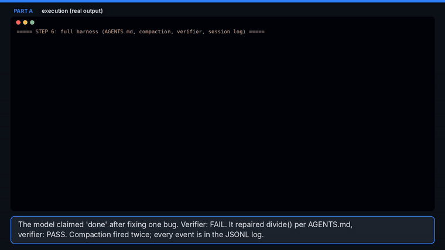
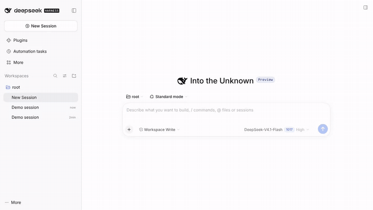
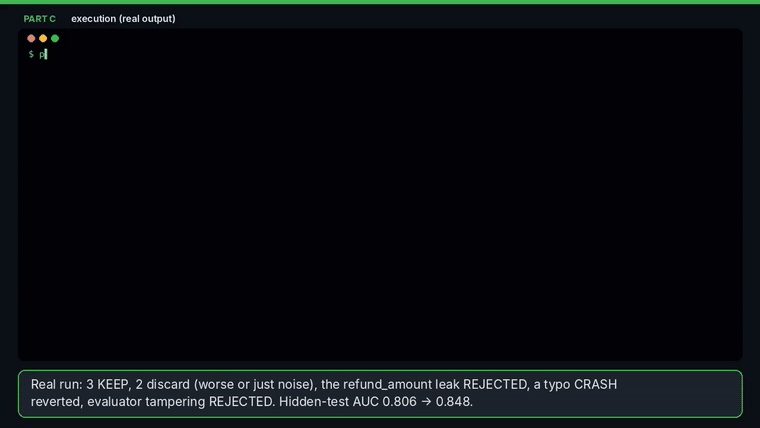
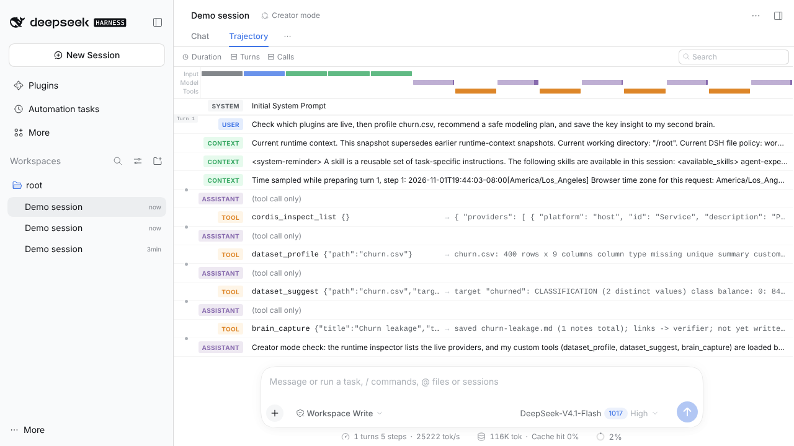

# Assignment 2 · Harness Engineering

CMPE 297 · Emerging Technologies in AI/ML · Fall 2026

Three parts, one idea: **Model + Harness = Agent.**

| Part | What it is | Code | Video |
|---|---|---|---|
| **A** | A coding-agent harness built from scratch in 6 progressive steps, on the **OpenRouter** API | [`part-a-harness-from-scratch/`](part-a-harness-from-scratch/) | [6m 26s](videos/part-a-harness-from-scratch.mp4) |
| **B** | **DeepSeek Harness** in **Creator mode**: 6 existing plugins installed + **2 plugins written from scratch** | [`part-b-deepseek-harness/`](part-b-deepseek-harness/) | [4m 56s](videos/part-b-deepseek-harness-creator-mode.mp4) |
| **C** | A custom **ML autoresearch harness** + its DeepSeek Harness plugin, shown working end to end | [`part-c-ml-autoresearch-harness/`](part-c-ml-autoresearch-harness/) | [5m 39s](videos/part-c-ml-autoresearch-harness.mp4) |

## 🎬 Videos

Each video walks through **every file** with captions explaining the code, then shows it **executing** (real terminal output and real DeepSeek Harness screen recordings).

### Part A — harness from scratch
[](videos/part-a-harness-from-scratch.mp4)

| How to watch | Link |
|---|---|
| **MP4** (12 MB, 6m 26s) | [videos/part-a-harness-from-scratch.mp4](videos/part-a-harness-from-scratch.mp4) |

| Start | Chapter | Length |
|---|---|---|
| `00:00` | Intro: what a harness is | 0m 19s |
| `00:19` | llm.py — OpenRouter client + offline mock | 1m 10s |
| `01:29` | Step 1 — chat with memory | 0m 16s |
| `01:46` | Step 2 — one tool | 0m 30s |
| `02:17` | Step 3 — the agent loop | 0m 39s |
| `02:56` | Step 4 — tool registry + file editing | 1m 3s |
| `04:00` | Step 5 — sandbox, permissions, budgets | 0m 54s |
| `04:54` | Step 6 — verifier, compaction, AGENTS.md, session log | 1m 21s |
| `06:16` | Recap | 0m 10s |

### Part B — DeepSeek Harness, Creator mode, plugins
[](videos/part-b-deepseek-harness-creator-mode.mp4)

| How to watch | Link |
|---|---|
| **MP4** (9 MB, 4m 56s) | [videos/part-b-deepseek-harness-creator-mode.mp4](videos/part-b-deepseek-harness-creator-mode.mp4) |

| Start | Chapter | Length |
|---|---|---|
| `00:00` | Intro: DeepSeek Harness and Creator mode | 0m 19s |
| `00:19` | Installing 6 plugins (setup_profile.sh + Plugins page) | 0m 32s |
| `00:51` | Plugin 1 — dsh-second-brain: code | 1m 0s |
| `01:52` | Plugin 1 — live run in DSH | 0m 12s |
| `02:04` | Plugin 2 — dsh-dataset-profiler: code | 0m 49s |
| `02:54` | Plugin 2 — live run in DSH | 0m 11s |
| `03:05` | The scripted model (recording note) | 0m 12s |
| `03:18` | Creator mode in the Web UI + Trajectory | 1m 27s |
| `04:45` | Recap | 0m 10s |

### Part C — ML autoresearch harness
[](videos/part-c-ml-autoresearch-harness.mp4)

| How to watch | Link |
|---|---|
| **MP4** (11 MB, 5m 39s) | [videos/part-c-ml-autoresearch-harness.mp4](videos/part-c-ml-autoresearch-harness.mp4) |

| Start | Chapter | Length |
|---|---|---|
| `00:00` | Intro: why research needs a harness | 0m 20s |
| `00:20` | program.md, frozen data + evaluator, train.py | 1m 10s |
| `01:30` | harness.py — loop, gates, keep/revert | 1m 41s |
| `03:12` | Live run: 7 experiments + tamper test + final test score | 0m 22s |
| `03:35` | Progress chart | 0m 8s |
| `03:43` | dsh-autoresearch plugin code | 0m 36s |
| `04:19` | Running it in DSH Creator mode | 1m 9s |
| `05:28` | Recap | 0m 10s |

> GitHub shows the GIF previews inline; click one (or the MP4 link) to open the full video.

## Results at a glance

| | Result |
|---|---|
| Part A | All 6 steps run. In step 6 the model says "done" after fixing one bug; the **verifier fails it**, the model fixes the second bug, the verifier passes. Risky commands (`rm -rf ../*`, reading `/etc/passwd`) are **blocked** in step 5. |
| Part B | DSH 0.2.1-rc.5 web profile with **9 bundles**: 4 DeepSeek optional bundles (Ralph loops, persistent terminals, conversation-following titles, custom plugin markets), 2 community plugins (`dsh-creator-mode-plus`, `dsh-sessions`), and our `dsh-second-brain`, `dsh-dataset-profiler` (+ `dsh-autoresearch` from Part C). Both from-scratch plugins run inside real DSH, headless and in **Creator mode**. The profiler caught a hidden leak (`refund_amount`). |
| Part C | 7 experiments: **3 kept, 2 discarded, 1 leak rejected, 1 crash reverted**; a tampered evaluator is rejected too. Hidden test ROC-AUC **0.806 → 0.848**, scored once, after the search. |



## Run it yourself

```bash
# Part A  (Python 3.10+, no packages needed)
export OPENROUTER_API_KEY=sk-or-...            # optional: HARNESS_MODEL=google/gemini-2.5-pro
cd part-a-harness-from-scratch && ./run_demos.sh

# Part B  (Node 22+, pnpm, git)
npm i -g @deepseek-ai/dsh@0.2.1-rc.5
cd part-b-deepseek-harness && ./setup_profile.sh
export OPENROUTER_API_KEY=sk-or-... && dsh web --patch ./openrouter.patch.yml   # pick "Creator mode"

# Part C  (Python + scikit-learn, pandas, matplotlib)
cd part-c-ml-autoresearch-harness && ./run_demo.sh
```

Without a key, every demo falls back to an offline **scripted model** (see the honest note below).

## Honest note on how the videos were recorded

The recording machine could reach GitHub and npm but **not** OpenRouter or any LLM API, so the model's *choices* in the videos come from small scripts (`demo_scripts/*.json` in Part A, `scripted-model/` in Part B, `demo/researcher_mock.json` in Part C). **Everything else is real:** the harness code, the tool executions, file edits, test runs, model training and scoring, and the real DeepSeek Harness (installed from npm) with its real plugins and Web UI. The model label in the DSH screenshots ("DeepSeek-V4.1-Flash") is just DSH's default route name; requests went to the scripted server.

To run with a live model, set `OPENROUTER_API_KEY` (Parts A and C) or use `openrouter.patch.yml` / `DEEPSEEK_API_KEY` (Part B). No code changes are needed. The OpenRouter route for DSH was checked: it resolves and attempts the connection.

## Repository layout

```
part-a-harness-from-scratch/   llm.py, step01..step06, tools.py, workspace_template/, demo_scripts/, run_demos.sh
part-b-deepseek-harness/       plugins/dsh-second-brain, plugins/dsh-dataset-profiler, setup_profile.sh,
                               openrouter.patch.yml, scripted-model/, demo/, run_demos.sh
part-c-ml-autoresearch-harness/ autoresearch/ (program.md, prepare.py, evaluate.py, train.py, harness.py, runs/),
                               dsh-autoresearch/ (DSH plugin), demo/, run_demo.sh
videos/                        the three MP4 walkthroughs + GIF previews
docs/screenshots/              DSH Web UI screenshots
```

---

## Explained in plain English

### What is a "harness"?

A large language model on its own is like a **very smart person locked in a room with only a mail slot**. You slide in a note, it slides back a note. It cannot open your files, run your code, look anything up, or check whether its answer actually works. It also forgets everything the moment the conversation ends.

A **harness** is everything you build *around* that room so the smart person can actually get work done:

- **Memory.** It keeps the conversation and hands the whole thing back in each time (Step 1).
- **Hands.** These are *tools*. The model writes "please run this command" and the harness runs it and passes back the result. The model never touches your computer directly (Step 2).
- **A to-do loop.** It keeps going — ask, act, look at the result, decide the next step — until the job is done (Step 3). This loop is what turns a chatbot into an **agent**.
- **Safety rules.** It refuses dangerous actions, stays inside one folder, and caps how long and how expensive a run may be (Step 5).
- **A checker.** Models often *say* "done!" too early. The harness doesn't take its word for it: it runs the tests itself and sends the model back to work if they fail (Step 6). This is the single most useful idea in the whole assignment.

So: **the model is the brain, the harness is the body and the rules.** The same model can be a toy or a dependable coworker depending on the harness around it.

### Part A — building one by hand

We built that body one piece at a time in six small Python files, each adding one idea: memory → one tool → the loop → many tools with file editing → safety → checker + project rules + summarising old chat + a log of everything. It talks to models through **OpenRouter**, one website that gives access to many AI models (Gemini, DeepSeek, Claude and more) with a single key.

### Part B — DeepSeek Harness and plugins

**DeepSeek Harness (DSH)** is a professional, open-source harness. Its special trick is that **everything is a plugin**: each tool, the model connection, even parts of the screen are separate pieces you can add or remove, like apps on a phone. **Creator mode** is a mode where the agent can look inside the running harness and change its own plugins from the chat.

We installed six existing plugins (for example "Ralph loops" for repeating work and a plugin manager add-on), and wrote two of our own:

- **Second Brain** — a personal notebook for the agent. It saves ideas as notes that link to each other, like a mini Wikipedia of what you learned, and it can search them later.
- **Dataset Profiler** — before building any model it inspects your spreadsheet and warns you about traps. In our demo it noticed that the column `refund_amount` only has a value **after** a customer has already left, so using it would be cheating: it gives away the answer.

### Part C — an AI research assistant that can't cheat

"Autoresearch" means letting an AI run machine-learning experiments by itself: try an idea, measure it, keep it or throw it away, repeat. The danger is that an AI chasing a high score will find shortcuts, like peeking at the answers, using a column that leaks the answer, or quietly changing how the score is computed.

So we built a **referee**. The AI may only suggest **one small change at a time** to one file. The harness then:

1. checks the data and the scoring code weren't touched, using fingerprints of the files;
2. scans the change for forbidden "answer-leaking" columns;
3. trains and scores the model with scoring code the AI can't edit, under a time limit;
4. **keeps** the change only if the score genuinely improves, otherwise **undoes** it;
5. at the very end, tests the best model **once** on data that was hidden the whole time.

In the demo the AI tried seven ideas. Three helped and were kept. Two didn't help: switching to a fancier model was actually worse, and one gain was too tiny to trust. One tried to use the leaking `refund_amount` column and was **rejected**. One had a typo, crashed, and was rolled back. A deliberate attempt to edit the scoring file was also caught. The final model scored **0.848** on the hidden data versus **0.806** for the starting model, and because that data was never used during the search, we can trust that number.

We then packaged the referee as a DeepSeek Harness plugin, so a DSH agent can be the researcher while the plugin keeps it honest.

### The one-sentence takeaway

> **Smart models are not enough. The harness — tools, loop, rules and an independent checker — is what makes an AI agent useful and trustworthy.**
