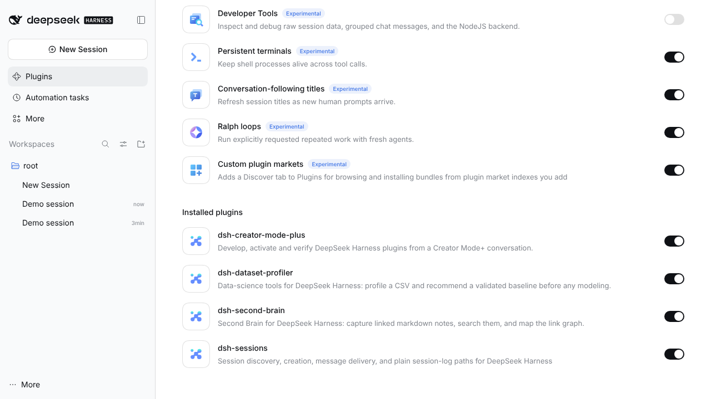
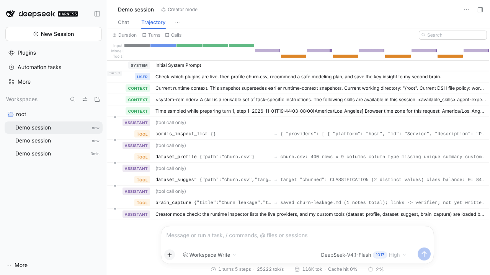

# Part B · DeepSeek Harness in Creator mode + plugins

🎬 **Video:** [../videos/part-b-deepseek-harness-creator-mode.mp4](../videos/part-b-deepseek-harness-creator-mode.mp4) (4m 56s: install, plugin code, live runs, Creator mode in the Web UI)

[DeepSeek Harness](https://github.com/deepseek-ai/deepseek-harness) (DSH) is built so that *everything is a plugin* ([Cordis](https://github.com/cordiverse/cordis)).
Tested with **DSH 0.2.1-rc.5** from npm.

## 1. Install DSH and customise the profile (6 existing plugins + ours)

```bash
npm i -g @deepseek-ai/dsh@0.2.1-rc.5
./setup_profile.sh          # installs everything below into the "web" profile
dsh web                     # open the UI, choose "Creator mode" in the mode menu
```

| # | Plugin | Source | What it adds |
|---|---|---|---|
| 1 | Ralph loops | DeepSeek optional bundle | `ralph` tool: repeat explicitly requested work with fresh agents |
| 2 | Persistent terminals | DeepSeek optional bundle | shells that survive across tool calls |
| 3 | Conversation-following titles | DeepSeek optional bundle | session titles that update as prompts arrive |
| 4 | Custom plugin markets | DeepSeek optional bundle | a Discover tab for plugin market indexes |
| 5 | [dsh-creator-mode-plus](https://github.com/aa2246740/dsh-creator-mode-plus) | community | fail-closed scaffold / check / activate flow for plugins |
| 6 | [dsh-sessions](https://github.com/Ephemeral-AI-Lab/dsh-plugins) | community | session discovery, creation and message delivery |
| 7 | **dsh-second-brain** | **written from scratch** | `brain_capture`, `brain_search`, `brain_graph` |
| 8 | **dsh-dataset-profiler** | **written from scratch** | `dataset_profile`, `dataset_suggest` |
| 9 | **dsh-autoresearch** | written from scratch (Part C) | `ar_program`, `ar_experiment`, `ar_status`, `ar_finalize` |

Notes from doing this for real:
- `dsh plugin add @deepseek-ai/dsh-experimental-…-bundle` without a version pulled an older **alpha** that DSH then disabled as incompatible; pinning to the running version fixed it.
- Linked community checkouts need their own runtime deps (`yaml`, `zod`); installed with `--ignore-scripts`.
- Ephemeral's `dsh-loop` was tried and **removed**: it imports `CallId` from DSH 0.1's `dsh-llm`, which no longer exists in 0.2.



## 2. The two plugins written from scratch

Both are plain ES-module bundles: `package.json` declares `dsh.bundle`, `cordis.patch.yml` inserts the plugin,
`index.js` exports `apply(ctx)` and registers tools with `defineTool` from `@deepseek-ai/dsh-tools`.

### `plugins/dsh-second-brain`
A Zettelkasten-style memory for the agent. Notes are Markdown files with front-matter tags and `[[wiki links]]`
(they open in Obsidian too). Search ranks title > tags > body and boosts notes with many backlinks.

**Prompt:** *"Remember what I learned about harnesses today, then tell me how the harness knows the loop is done."*

```
agent-loop          ->  verifier     [backlinks: 2]
context-compaction  ->  agent-loop   [backlinks: 0]
verifier            ->  agent-loop   [backlinks: 1]
```

### `plugins/dsh-dataset-profiler`
Data-science "eyes" before any modeling: column types, missingness, stats, ID-like and constant columns, and two
leakage checks (near-perfect correlation, and *non-zero exactly when the target is positive*).

**Prompt:** *"Profile churn.csv and tell me how to model churn safely."*

```
target "churned": CLASSIFICATION   class balance 84% / 16%
metric: ROC-AUC + PR-AUC (imbalanced; accuracy would mislead)
split: time-based on "signup_date"
RED FLAGS:
  - "customer_id" looks like a row ID - exclude from features
  - "last_login_days" is 32% missing - impute or add a missing-indicator
  - LEAKAGE? "refund_amount" is non-zero almost exactly when "churned" is positive (100.0% agreement)
```

Run both inside real DSH (headless profile):

```bash
./run_demos.sh                                  # offline: scripted model
USE_REAL_MODEL=1 DEEPSEEK_API_KEY=... ./run_demos.sh
```

## 3. Creator mode in the Web UI

**Prompt:** *"Check which plugins are live, then profile churn.csv, recommend a safe modeling plan, and save the key insight to my second brain."*

The agent used Creator mode's runtime inspector (`cordis_inspect_list`) and then our tools. The **Trajectory** tab shows each step:



## Using OpenRouter (or Gemini) as DSH's model

`openrouter.patch.yml` routes DSH through its built-in `dsh-llm-pi-ai` adapter:

```bash
export OPENROUTER_API_KEY=sk-or-...
dsh web --patch ./openrouter.patch.yml     # model: any OpenRouter id, e.g. google/gemini-2.5-pro
```

## `scripted-model/` (recording only)

The recording sandbox had no LLM access. `scripted-model.mjs` speaks the Anthropic-Messages SSE protocol that DSH's
DeepSeek adapter uses (`DEEPSEEK_BASE_URL`) and replays `demo/*.json`. DSH, the plugins and every tool result are real;
only the model's choices are pre-written. It also logs which tools DSH offered on each request, which proves the plugins
were registered (`plugin tools: brain_capture, brain_graph, brain_search, dataset_profile, dataset_suggest`).
