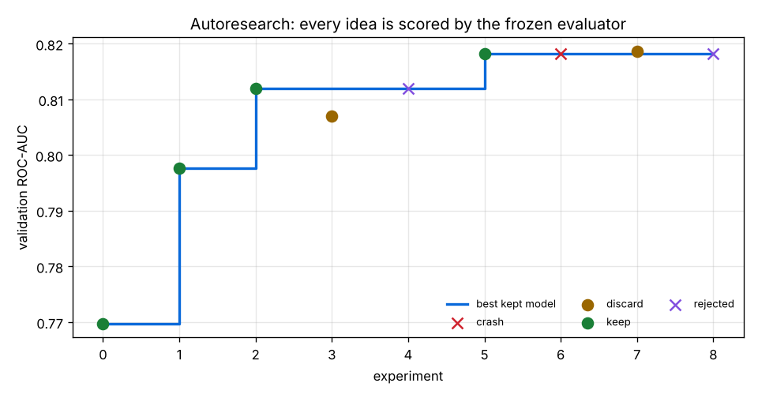
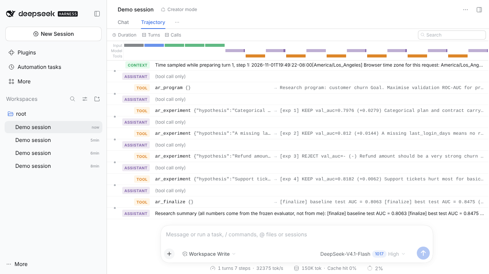

# Part C · A custom ML harness for autoresearch (end to end)

🎬 **Video:** [../videos/part-c-ml-autoresearch-harness.mp4](../videos/part-c-ml-autoresearch-harness.mp4) (5m 39s: code walkthrough, live run, DSH Creator mode)

An "autoresearch" loop in the spirit of Karpathy's *autoresearch* and AIDE-style agents: an AI researcher proposes
experiments, and the **harness** is the referee. The AI can only change `train.py`, one idea at a time. Everything that
decides whether an idea worked is frozen and enforced in code.

```
propose (hypothesis + edit) -> apply -> GATES -> frozen evaluator (time budget) -> keep / discard / crash / reject -> log
finalize: refit best on train+val, score the hidden test split ONCE, write runs/report.md
```

| File | Role |
|---|---|
| `autoresearch/program.md` | the research brief the AI reads: goal + 5 rules |
| `autoresearch/prepare.py` | **frozen**: generates 6,000-customer churn data and a time split (train Jan–Aug, val Sep–Oct, hidden test Nov–Dec) |
| `autoresearch/evaluate.py` | **frozen**: the only code allowed to compute ROC-AUC; never gives the candidate the target column |
| `autoresearch/train.py` | the only editable file: `make_features(df)` + `build_model()` (starts from `train_baseline.py`) |
| `autoresearch/harness.py` | the loop, gates, keep/revert, leaderboard, finalize, report |
| `autoresearch/plot.py` | `runs/progress.png` |
| `dsh-autoresearch/` | the same engine as a **DeepSeek Harness plugin** (`ar_program`, `ar_experiment`, `ar_status`, `ar_finalize`) |
| `demo/researcher_mock.json` | the 7 scripted proposals used for the offline recording |

### The gates (anti-cheat)
| Gate | Catches |
|---|---|
| frozen hashes | any edit to `prepare.py`, `evaluate.py` or the data files |
| leakage scan | `train.py` using `refund_amount` (recorded after churn), the target, or `test.csv` |
| time budget | experiments that run longer than `--budget` seconds |
| noise threshold | "improvements" smaller than 0.001 AUC are discarded |
| sanity | jumps above +0.08 (or AUC > 0.98) are held for human review |
| test once | the hidden split is scored only in `finalize` |

## Run

```bash
pip install scikit-learn pandas matplotlib
export OPENROUTER_API_KEY=sk-or-...            # researcher = any OpenRouter model (optional HARNESS_MODEL)
./run_demo.sh                                  # without a key: replays demo/researcher_mock.json

# by hand
cd autoresearch
python prepare.py && python harness.py reset
python harness.py run --iterations 10
python harness.py step --hypothesis "..." --edits '[{"old": "...", "new": "..."}]'
python harness.py status && python harness.py finalize && python plot.py
```

The LLM client is Part A's `llm.py` (reused, not copied).

## Results (real run, `runs/`)

| exp | status | val AUC | delta | hypothesis |
|---:|---|---:|---:|---|
| 0 | keep | 0.7697 | | baseline: logistic regression on numeric columns |
| 1 | **keep** | 0.7976 | +0.0279 | one-hot encode plan and contract |
| 2 | **keep** | 0.8120 | +0.0144 | missing-indicator for last_login_days |
| 3 | discard | 0.8070 | −0.0050 | switch to HistGradientBoosting (worse here) |
| 4 | **rejected** | – | – | add refund_amount → leakage gate |
| 5 | **keep** | 0.8182 | +0.0062 | tickets × basic plan × monthly contract interaction |
| 6 | crash | – | – | typo `tenure_mnths` → KeyError, reverted |
| 7 | discard | 0.8187 | +0.0005 | south-region flag (gain below noise threshold) |
| 8 | **rejected** | – | – | tamper test: `evaluate.py` modified → frozen-hash gate |

**Hidden test ROC-AUC: baseline 0.806 → best 0.848** (scored once, after the search).



## Inside DeepSeek Harness

```bash
dsh plugin --profile web add ./dsh-autoresearch
AUTORESEARCH_DIR=$PWD/autoresearch dsh web     # Creator mode: "Run an autoresearch session on the churn program..."
```

The DSH agent becomes the researcher; the plugin forwards each proposal to `harness.py`, so every number comes from the
frozen evaluator. The running Web UI hot-loaded the plugin without a restart.



## Related harnesses studied
[karpathy/autoresearch](https://github.com/karpathy/autoresearch) (single editable file, fixed time budget, keep/revert),
[WecoAI/aideml](https://github.com/WecoAI/aideml) (tree search over solutions),
[SWE-agent/mini-swe-agent](https://github.com/SWE-agent/mini-swe-agent) (minimal bash-only loop),
and the course's [dlmastery/simple-coding-harness](https://github.com/dlmastery/simple-coding-harness) (loop / graph / meta-harness chapters).
This harness adds the integrity layer (frozen hashes, leakage scan, noise threshold, test-once) and a DSH plugin front end.
