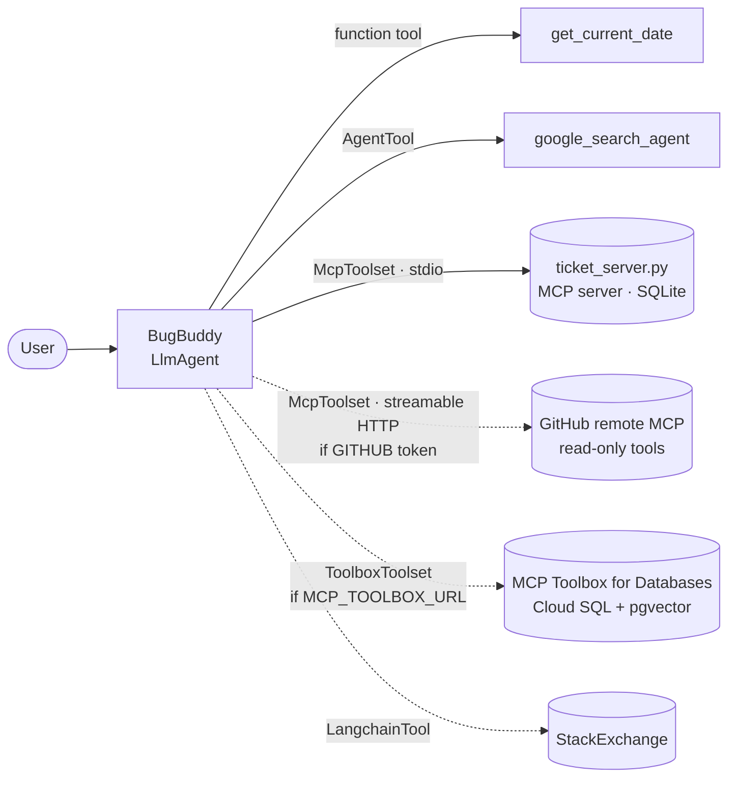

# (c) MCP-tools based bug assistant — "BugBuddy"

A triage and debugging assistant for **QuantumRoast**, a fictional smart-coffee-machine company (web portal, mobile app, firmware, billing). It searches for duplicate tickets, creates and updates tickets, and researches fixes. All ticket access goes through the **Model Context Protocol**.

## Architecture



ADK starts `ticket_server.py` as a subprocess and lists its tools over MCP. The same server works with any MCP client:

```bash
npx @modelcontextprotocol/inspector python bug_assistant_agent/mcp_server/ticket_server.py
```

## Code walkthrough

| File | What to look at |
|---|---|
| `mcp_server/ticket_server.py` | The MCP server: 9 tools (`search_tickets`, `get_ticket_by_id`, `get_tickets_by_{assignee,status,priority,date_range}`, `create_new_ticket`, `update_ticket_{status,priority}`). Each carries MCP **ToolAnnotations** (`readOnlyHint` / `destructiveHint`). Enum values are validated server-side. `create_new_ticket` returns likely duplicates. A lock serialises DB access because MCP runs sync tools on worker threads (the offline tests caught this). Works with both `mcp` 1.x (`FastMCP`) and 2.x (`MCPServer`). |
| `mcp_server/ticket_db.py` | SQLite schema, seeding from `seed_tickets.json` (14 realistic tickets), and TF-IDF cosine search that returns a `distance` like pgvector's `<=>`. |
| `tools.py` | Shows **four kinds of ADK tools**: a function tool, a built-in tool wrapped in `AgentTool` (google_search can't sit next to other tools on one agent), `McpToolset` over stdio and streamable HTTP, and an optional `LangchainTool`. `build_tools()` switches to MCP Toolbox when `MCP_TOOLBOX_URL` is set and only adds GitHub when a token exists. |
| `prompts.py` | Triage procedure: always search before creating, P0–P3 rubric, confirm before updates, Markdown tables for 2+ tickets. |
| `deployment/toolbox/` | The production version: `tools.yaml` for MCP Toolbox over Cloud SQL Postgres with `embedding('text-embedding-005', …)` vector search, and `schema.sql` with a trigger that keeps embeddings in sync. |

## Run it

```bash
adk web      # choose bug_assistant_agent  (DB is created on first start in bug_assistant_agent/data/)
```

Demo prompts:

1. *"Our customers say they got charged twice for their bean subscription. Is there already a ticket?"* → `search_tickets` finds #11 (distance ≈ 0.5)
2. *"Show me all open P0 and P1 tickets in a table."*
3. *"Create a ticket: the Espresso Pro steam wand keeps dripping water after brewing finishes."* → searches first, then creates with a suggested priority
4. *"What tickets were created in the last 30 days?"* → `get_current_date` + `get_tickets_by_date_range`
5. *"Search the web for best practices to make payment retries idempotent."*

Optional: put `GITHUB_PERSONAL_ACCESS_TOKEN=...` in `.env` and ask *"Find open issues about MCP in google/adk-python"*.

## Changes vs. the reference sample

The reference needs a Cloud SQL instance plus the Toolbox binary before it can start. Here, a self-written MCP server makes it run anywhere, and the Toolbox path is kept as a one-variable switch. The local server also adds server-side validation, duplicate detection on create, tool annotations and thread safety.
