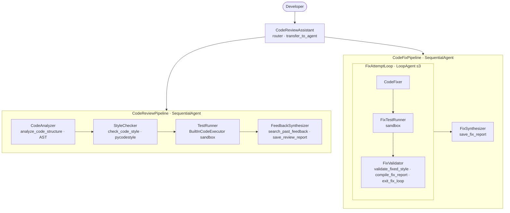

# (d) Production-quality code review assistant

Reviews Python code like a senior engineer. The numbers (complexity, style score, before/after deltas) are computed deterministically in code. Tests are **written and executed** in Gemini's sandboxed code executor. Feedback is personalised with the developer's history, and an optional auto-fix loop iterates until the fix verifiably works.

## Architecture



## Code walkthrough

| File | What to look at |
|---|---|
| `tools.py` | **`analyze_code_structure`**: AST parse, per-function length, args, docstring and type-hint presence, **cyclomatic complexity**, and risk flags (`eval`/`exec`, bare `except`, mutable default args). Syntax errors come back with a line number. **`check_code_style`**: pycodestyle with a custom reporter plus naming checks (N801/N802), producing a weighted 0–100 score. **`save_review_report`**: appends to `user:review_history` (the `user:` prefix makes it persist across sessions) and saves `review_NNN.md` as a versioned artifact. **`compile_fix_report`**: unified diff, style and test verdicts before/after, and a SUCCESSFUL / PARTIAL / FAILED status. **`exit_fix_loop`**: sets `actions.escalate`. |
| `constants.py` | One `StateKeys` class shared by every agent and tool, so no magic strings. |
| `sub_agents/review_pipeline.py` | The `TestRunner` uses a **callable instruction** that injects the code verbatim (code contains `{}` that would break template substitution) and `BuiltInCodeExecutor`, so untrusted code never runs on your machine. |
| `sub_agents/fix_pipeline.py` | `LoopAgent(max_iterations=3)`. Each attempt sees the previous fix report and improves on it. The validator escalates only when the computed status is SUCCESSFUL. |
| `agent.py` | Root router with `sub_agents=[…]`. After a review, the next user turn returns to the root, which transfers to the fix pipeline on "yes". |

## Run it

```bash
adk web      # choose code_review_assistant
```

Paste:

```python
def calculate_average(numbers=[]):
    total=0
    for n in numbers: total+=n
    return total/len(numbers)

def ProcessData(data):
    result = eval(data)
    try:
        return result*2
    except:
        pass
```

Expect it to flag the ZeroDivisionError on `[]`, the mutable default, `eval` and the bare `except`, give a style score of about 50, and offer to fix. Reply *"yes, fix it"*, then compare `review_001.md`, `fixed_code.py` and `fix_report.md` in the Artifacts tab. Review a second snippet in the same browser session to see the history-aware feedback.

## Changes vs. the reference repo

- Scoring and complexity are deterministic and unit-tested.
- Adds security and risk flags and naming checks.
- Simpler `.env` configuration with no GCP requirement.
- History is kept in `user:` state instead of requiring Cloud SQL.
- Fixed code is saved as a downloadable `.py` artifact.
- An offline test proves the loop runs twice and stops on success.
