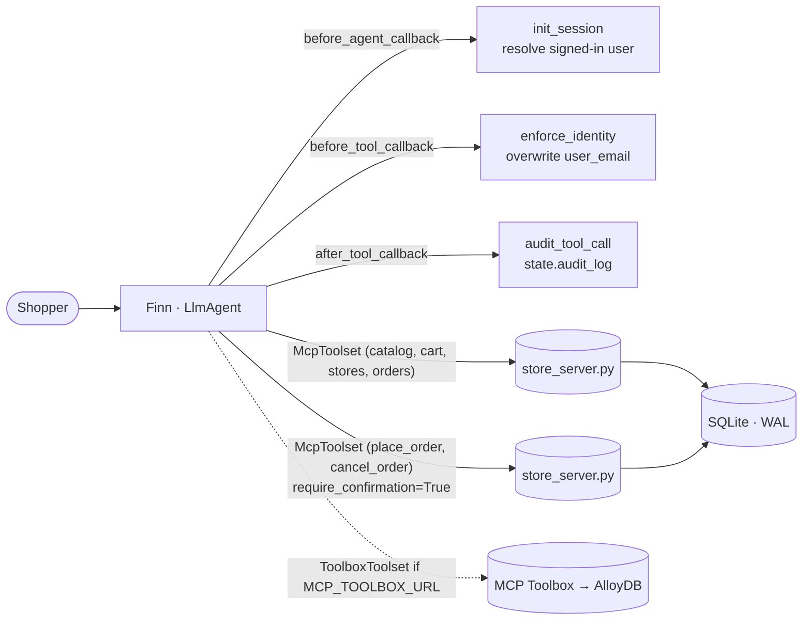

# (e) Production-quality e-commerce agent — "Finn" for GenAI Sports

A shopping assistant for a fictional sporting-goods retailer. It covers product discovery, product details and stock, a shopping list, a store finder, delivery options, and the full order lifecycle (place, change delivery, cancel). All commerce data sits behind an **MCP server**, and the production safeguards are enforced in **code**, not prompts.

## Architecture



## Code walkthrough

| File | What to look at |
|---|---|
| `mcp_server/store_server.py` | 13 MCP tools: `search_products`, `search_products_by_brand`, `get_product_details`, `check_inventory`, `add_to_shopping_list`, `remove_from_shopping_list`, `show_shopping_list`, `find_nearby_stores` (haversine distance), `list_delivery_methods`, `place_order`, `check_order_status`, `update_order_delivery_method`, `cancel_order`. **`place_order` is transactional** (`BEGIN IMMEDIATE`): it checks stock for every line at the chosen store, reserves inventory, writes the order and items, and clears the list, rolling back with a helpful error if anything is short. Orders are scoped to their owner. Only pending orders can be changed or cancelled, and cancelling restocks. |
| `mcp_server/store_db.py`, `store_seed.py` | Schema mirroring the reference AlloyDB design (products, variants, stores, inventory, delivery methods, shopping lists, orders, order items), 20 products, 4 Bay Area stores. Search scores each query term against name/brand, category and description, with light stemming and popularity as a tie-breaker. |
| `guards.py` | **`enforce_identity`** overwrites `user_email` on every call with the signed-in user (from `state["user:email"]`, an email-shaped ADK `user_id` from your auth layer, or the demo user), so a confused or prompt-injected model can't touch another customer's cart. **`audit_tool_call`** records executed write operations, skipping calls still awaiting confirmation. |
| `agent.py` | Two `McpToolset`s on the same server. The checkout toolset has `require_confirmation=True`, so `adk web` shows an **approve / reject dialog** before money moves (human in the loop). `MCP_TOOLBOX_URL` switches to the AlloyDB Toolbox. |
| `deployment/toolbox/tools.yaml` | Production config: AlloyDB source, vector search with `embedding('text-embedding-005', …)`, and `authServices: google` binding `user_email` to the verified Google ID token (the server-side equivalent of `enforce_identity`). |

## Run it

```bash
adk web      # choose ecommerce_agent (demo shopper: alex@example.com, Palo Alto)
```

Demo prompts:

1. *"I'm training for my first half marathon and need cushioned running shoes under $170."*
2. *"Tell me more about the Clifton 10."*
3. *"Add the Clifton 10 in size 9, White to my list."*
4. *"Show my shopping list and the stores near me."*
5. *"What delivery options does the Palo Alto store have?"*
6. *"Place the order at Palo Alto with Express Delivery."* → **confirmation dialog** → approve
7. *"Actually change it to Store Pickup, then show my orders."* (total drops by $14.99)
8. Robustness: *"Add 10 pairs"* then try to order (stock error, with a suggestion of another store); *"Cancel order 1"* twice (second attempt rejected).

Open the State tab to see `audit_log` and `user:email`.

## Changes vs. the reference repo

- Runs without AlloyDB, Cloud Run or a React frontend: the MCP server is self-contained and `adk web` is the UI.
- The reference had no stock reservation or rollback, no ownership checks on order changes, and no confirmation step. These are all added and covered by `tests/test_e_ecommerce.py`.
