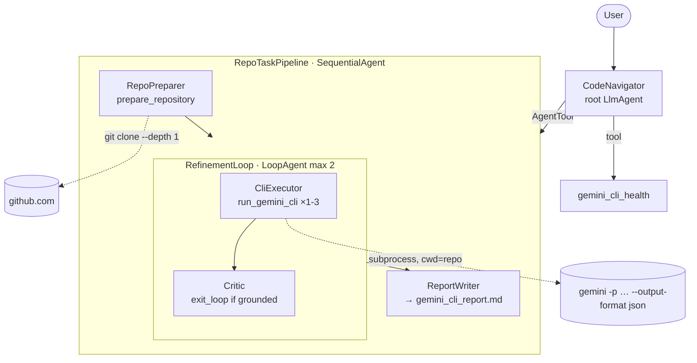

# (b) Advanced tool agent — Gemini CLI inside an ADK pipeline ("CodeNavigator")

The [Gemini CLI](https://github.com/google-gemini/gemini-cli) is an agent in its own right: in headless mode (`gemini -p "..."`) it discovers files, greps and reads a codebase by itself. Here it becomes a **tool** of an ADK agent. ADK handles orchestration, task decomposition, self-critique and reporting, and the CLI does the codebase exploration.

## Architecture



## Code walkthrough

| File | What to look at |
|---|---|
| `tools.py` | **`prepare_repository`** validates the URL against a strict `https://github.com/<owner>/<repo>` regex, then shallow-clones with an argument list (no shell), reuses existing clones, and returns a layout summary. **`run_gemini_cli`** calls `subprocess.run([gemini, "-p", task, "--output-format", "json"], cwd=repo)`, so the task text can never be interpreted by a shell. It runs read-only unless `GEMINI_CLI_APPROVAL=yolo`, enforces a timeout, an output cap and a per-session call budget, parses the CLI's JSON (`response` + token `stats`), and logs every run to `state["cli_runs"]`. **`gemini_cli_health`** reports the installed version and auth. |
| `agent.py` | The pipeline. `capture_task` (a `before_agent_callback`) stores the request so every stage can read `{user_task}`. The `LoopAgent` pairs the executor with a **Critic** that calls `exit_loop` only when the draft cites real file paths; otherwise its critique feeds the next executor pass through `{critique}`. `save_report` writes the final answer as an artifact. |
| `prompts.py` | Executor prompt: break the task into at most 3 focused CLI prompts, each asking for file-path citations. |
| `Dockerfile`, `cloudbuild.yaml`, `deploy_cloud_run.sh` | Python + Node 20 + `@google/gemini-cli`, running as a non-root user. Deploys to Cloud Run with Vertex AI auth from the service account (`--no-allow-unauthenticated`). |

## Run it

```bash
npm install -g @google/gemini-cli     # once; it reuses GOOGLE_API_KEY from .env
adk web                               # choose gemini_cli_agent
```

Demo prompts:

1. *"Is the Gemini CLI tool working?"* → `gemini_cli_health`
2. *"Explain the architecture of https://github.com/google/adk-python and where tool calling is implemented."*
3. *"Now generate a test plan for its callbacks feature."* → reuses the cached clone

In the Events tab you can see the clone, each CLI prompt with its duration, the critic's verdict, and the loop exiting.

## Changes vs. the reference repo

The reference built a shell string (`f'gemini -p "{task}"'` with `shell=True`), so a crafted task or URL could inject commands. This version:

- uses argument lists everywhere and validates URLs and refs
- runs the CLI read-only by default, with a timeout, an output cap and a call budget
- uses JSON output mode
- adds a self-critique loop, a report artifact, a health tool, a non-root container, and offline tests that run a fake CLI binary (`tests/fixtures/fake_gemini_cli.py`)
