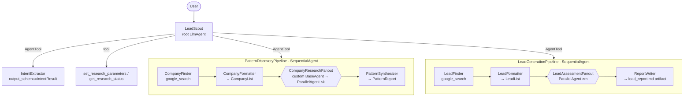

# (a) Deep-research lead generation agent — "LeadScout"

Finds B2B sales leads the way an analyst would: first study companies that already **succeeded** in a market, extract the **patterns** they shared before succeeding, then hunt for companies showing those patterns **right now**. Every company is researched by its own parallel sub-agent with Google Search grounding, and the run ends with a ranked Markdown report saved as an ADK artifact.

## Architecture



Each fan-out branch is `Researcher (google_search) → Formatter (output_schema)`.

## Code walkthrough

| File | What to look at |
|---|---|
| `agent.py` | Root `LeadScout`. Its only tools are three `AgentTool`s plus two function tools, so the root keeps control of the conversation while the pipelines do the heavy work. `before_agent_callback=init_state` and `after_tool_callback=update_stage` drive the state machine. |
| `callbacks.py` | **State transitions happen in code, not in the prompt.** After `IntentExtractor` runs, `update_stage` copies country/industry/k/m into state, clamps k and m, and resets stale patterns if the market changed. After each pipeline it advances `stage` to `patterns_ready` → `leads_ready`. `save_report_artifact` stores the final report with `callback_context.save_artifact`. |
| `sub_agents/research_fanout.py` | **The "deep" in deep research.** `ParallelAgent` needs its children at construction time, but the number of companies is only known at runtime. `ResearchFanoutAgent._run_async_impl` reads the list from state, builds one `Sequential[Researcher → Formatter]` per item, runs them all in a `ParallelAgent`, then fans the results back into one state key. Instructions are passed as callables so the JSON embedded in them isn't treated as `{state}` templates. |
| `sub_agents/pipelines.py` | The two pipelines. Gemini can't combine the built-in `google_search` tool with a JSON `output_schema` in one call, so every search agent is followed by a formatter with `include_contents="none"` (it only sees the notes it must convert). |
| `schemas.py` | Pydantic contracts between stages (`CompanyResearch`, `PatternReport`, `LeadAssessment` with a 0–100 `fit_score`). |
| `prompts.py` | All prompts. The root prompt uses optional templates such as `{country?}` so it renders before anything is known. |

## Run it

```bash
adk web      # choose lead_generation_agent
```

Demo conversation:

1. *"I sell cloud cost-optimisation software. Find me leads among fintech companies in India."*
2. *"Study 3 companies."* → watch three `Pipeline_company_research_*` branches run concurrently in the Events tab; the agent lists the patterns.
3. *"Yes, find 5 leads."* → five assessment branches run, then the ranked table appears and `lead_report.md` shows up in the Artifacts tab.

## Changes vs. the reference repo

- The custom fan-out is one reusable class used for both companies and leads, instead of two copies.
- Research results are validated with Pydantic, and the formatter always receives the subject item so it can't mislabel a result.
- Cost guardrails: k and m are clamped to 1–10 in both the callback and the tool.
- A changed market invalidates stale patterns automatically.
- The report is persisted as a versioned artifact, not just shown in chat.
- Fully offline-testable (`tests/test_a_lead_generation.py`).
