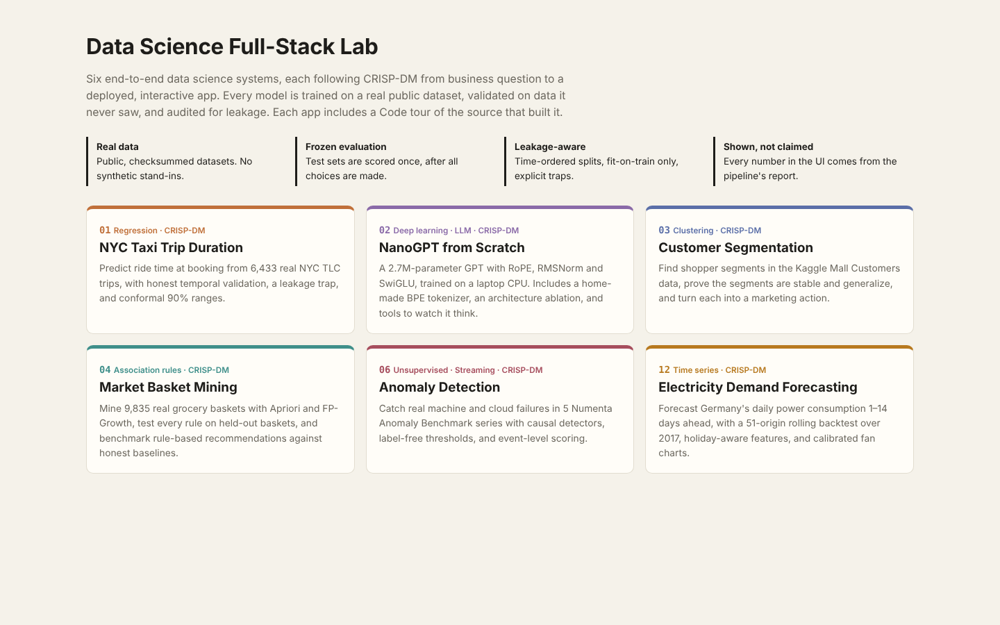
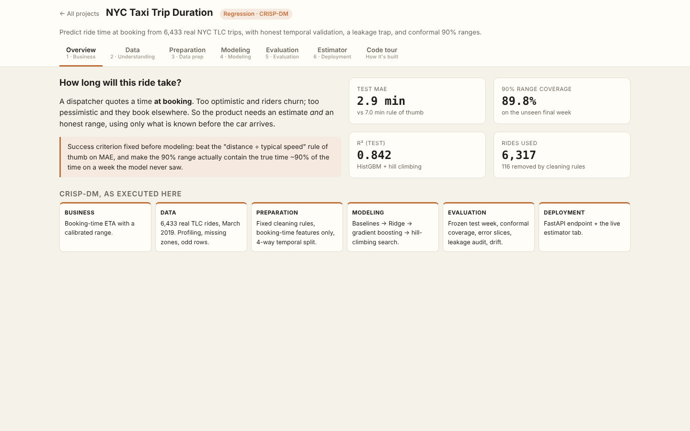
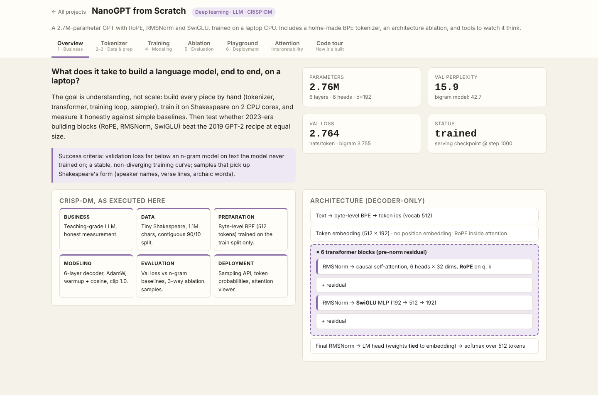
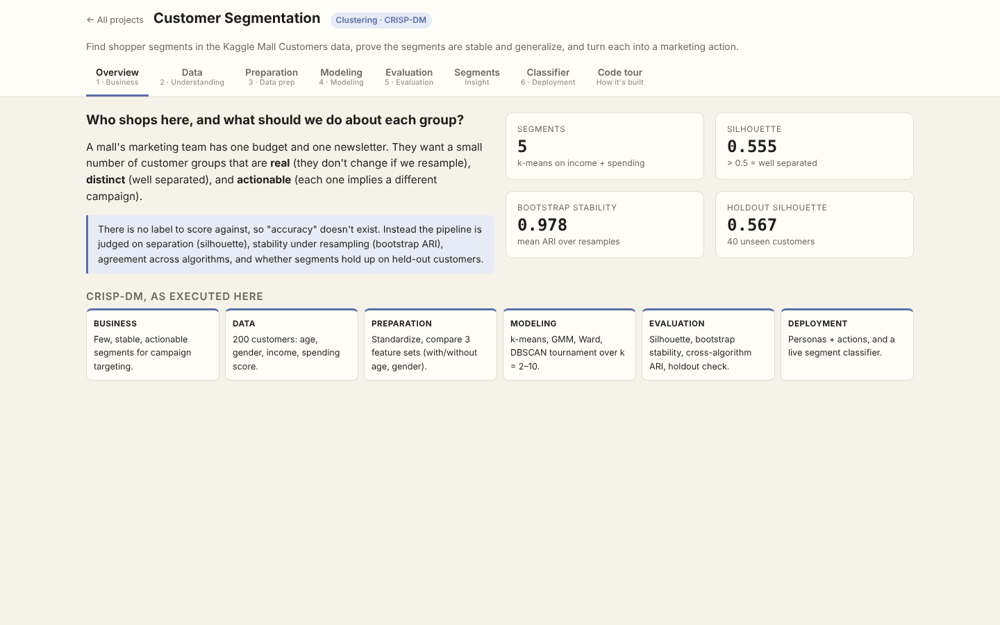
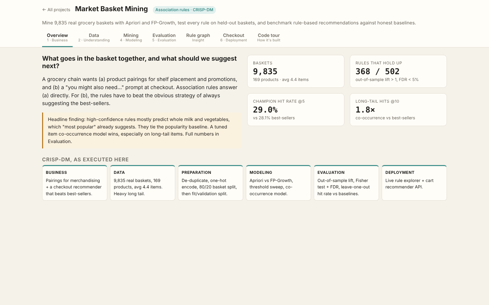
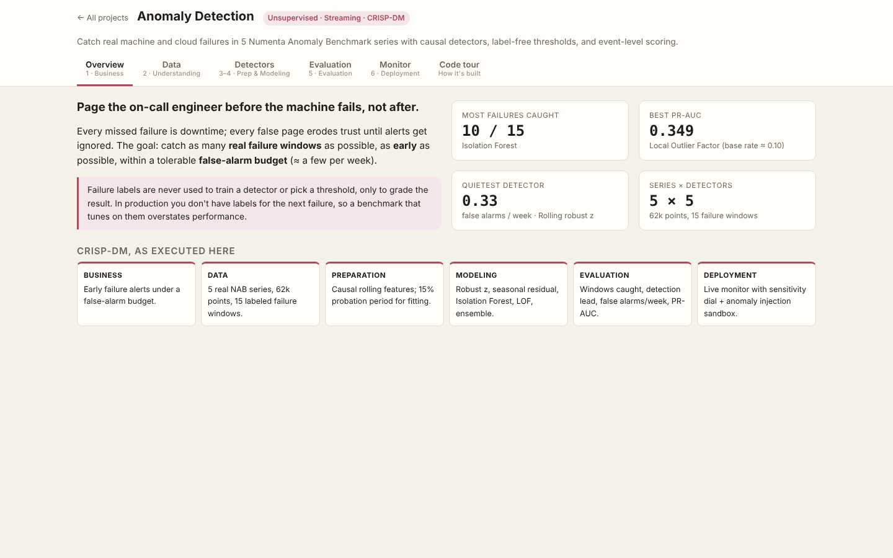
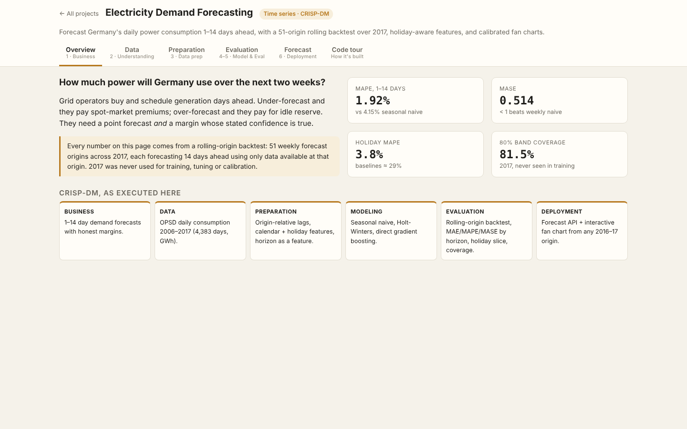

# Data Science Full-Stack Lab

Six end-to-end data science projects, each built from business question to deployed interactive app following **CRISP-DM**. They replicate (and extend) the experiments and prompts in [dlmastery/data_science_examples](https://github.com/dlmastery/data_science_examples), rebuilt with an AI coding assistant (Claude).

## 🎬 Video walkthrough

A 14-minute captioned tour of the code **and** the UX of every project, including each app's Code tour of its own source.

| How to watch | Link |
|---|---|
| **Download the MP4** (9 MB, plays in any video player) | [walkthrough.mp4](https://drive.google.com/file/d/1S8wBjR_qyN4oXEHe7Xev-Qh-AMnbu07u/view?usp=sharing) |

| Start | Chapter | Length |
|---|---|---|
| `00:00` | Introduction | 0m 36s |
| `00:36` | 01 · NYC taxi trip duration | 3m 2s |
| `03:39` | 02 · NanoGPT from scratch | 2m 47s |
| `06:26` | 03 · Customer segmentation | 2m 5s |
| `08:31` | 04 · Market basket mining | 2m 9s |
| `10:41` | 06 · Anomaly detection | 1m 55s |
| `12:36` | 12 · Electricity demand forecasting | 1m 51s |
| `14:28` | Wrap-up | 0m 16s |



## Projects
| Project | Headline result (from report.json) | Overview |
|---|---|---|
| [**NYC Taxi Trip Duration**](projects/01_nyc_taxi) | MAE 2.9 min; 90% range covers 89.8% |  |
| [**NanoGPT from Scratch**](projects/02_nano_llm) | val perplexity 15.9 vs bigram 42.7 |  |
| [**Customer Segmentation**](projects/03_customer_segments) | k=5, silhouette 0.55, stability 0.98 |  |
| [**Market Basket Mining**](projects/04_market_basket) | 368 rules survive held-out test; co-occurrence wins hit@5 |  |
| [**Anomaly Detection**](projects/06_anomaly_detection) | up to 10/15 failures caught with label-free thresholds |  |
| [**Electricity Demand Forecasting**](projects/12_timeseries_forecasting) | MAPE 1.92% (MASE 0.51), holiday-aware |  |

## What's different from the source repo
The source prompts asked for CRISP-DM, dashboards, "autoresearch" hill climbing and no leakage. This replication keeps all of that and adds:

1. **Real data everywhere.** The source projects generate synthetic data; here every model trains on a real public dataset fetched by `data/fetch_data.py` and pinned by SHA-256 in `data/MANIFEST.json`.
2. **Validation that matches deployment.** Temporal splits for taxi rides, rolling-origin backtests for forecasting, probation-only fitting for streaming anomalies, holdout checks even for clustering.
3. **Leakage tested, not just claimed.** pytest checks that changing the future never changes past features or scores (taxi, anomaly, forecasting, LLM causal mask), plus a deliberate leakage demo in the taxi app.
4. **Uncertainty that keeps its promise.** Conformal intervals, with achieved coverage reported next to the target.
5. **Honest negative results.** When the fancy method doesn't win (association rules vs best-sellers, the anomaly ensemble), the app says so and tries a better idea.
6. **Code tour inside every app.** Annotated source pulled live from the repo, so the walkthrough covers both the UX and the code.

## Quick start
```bash
pip install -r requirements.txt
python data/fetch_data.py        # downloads + checksums all datasets (~4 MB)
python serve.py                  # → http://127.0.0.1:8000
python -m pytest                 # all guardrail tests
```
Trained artifacts are committed, so the apps work immediately. Re-train any project with its pipeline script (see each README).

## Repository layout
```
data/fetch_data.py         real datasets + SHA-256 manifest
shared/hub.py              one FastAPI app that mounts every project + the code-tour endpoint
shared/static/             design system (shell.css), UI shell (shell.js), offline Plotly
projects/<nn_name>/        pipeline · app.py · static UI · code_tour.json · tests · artifacts · screenshots
scripts/screenshots.py     browser test: opens every tab, fails on JS errors, saves screenshots
scripts/record_video.py    records the captioned walkthrough with Playwright + ffmpeg
scripts/build_readmes.py   regenerates all READMEs from the reports
PROMPTS.md                 the prompts used (assignment, source prompts, improvised build prompts)
```

## Prompts
See **[PROMPTS.md](PROMPTS.md)** for the assignment prompt, the original project prompts, and the expanded per-project prompts that this build followed.
