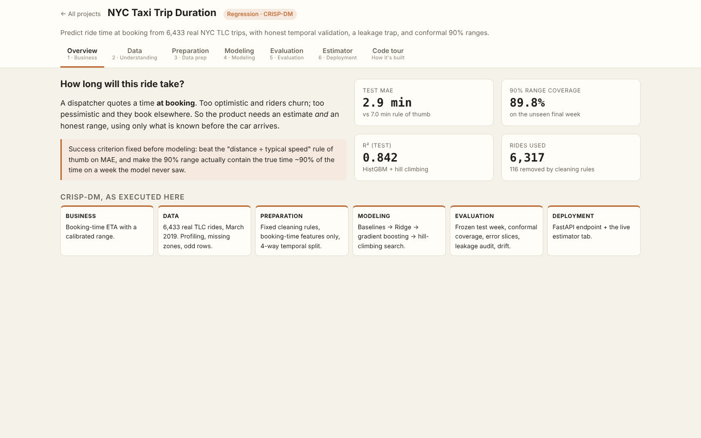
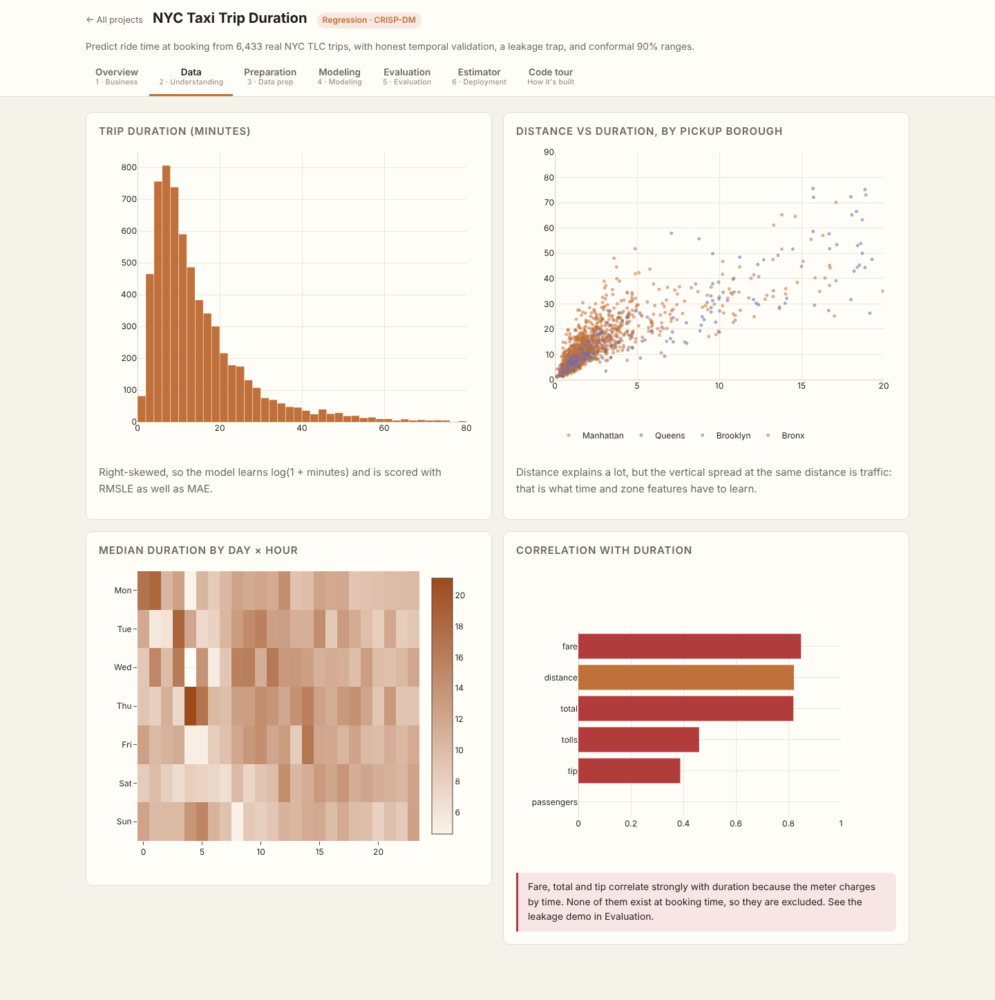
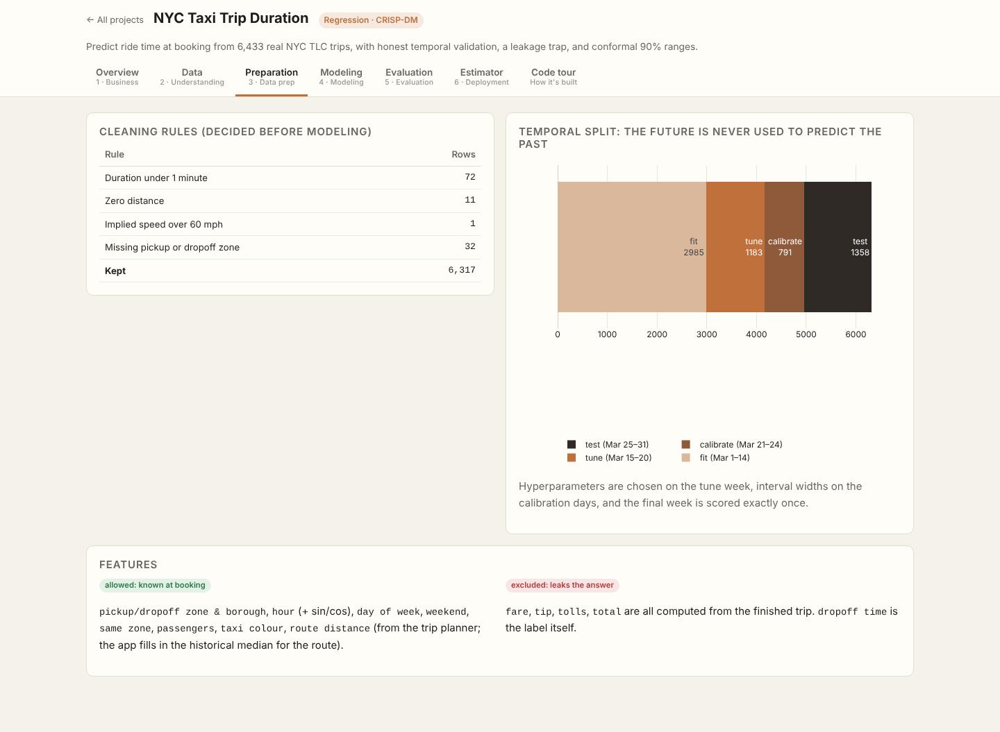
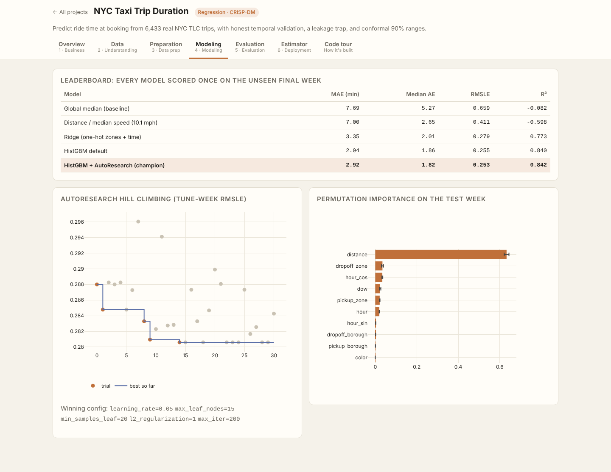
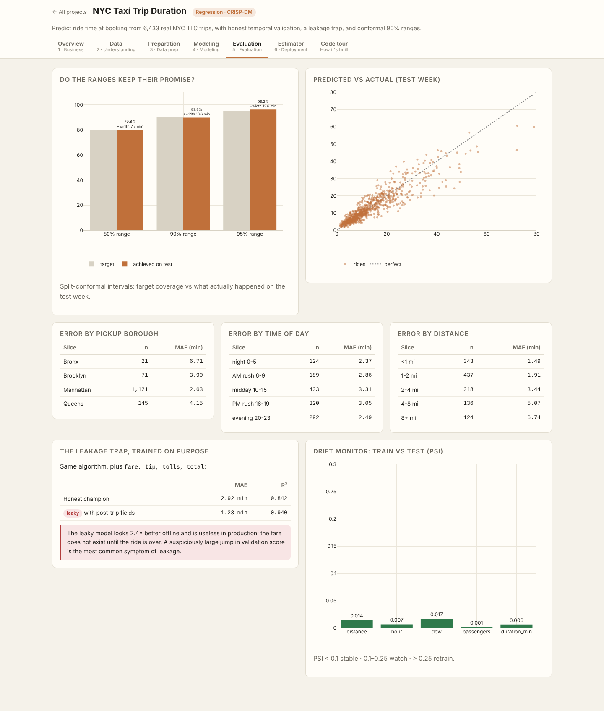
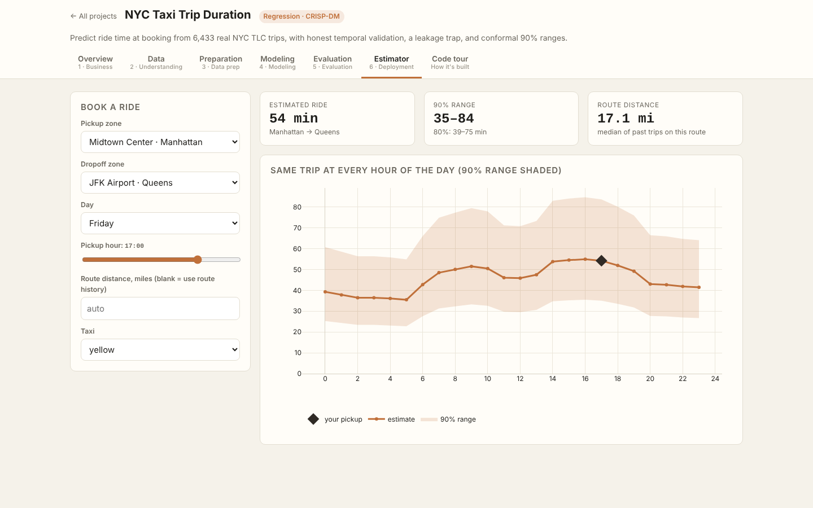
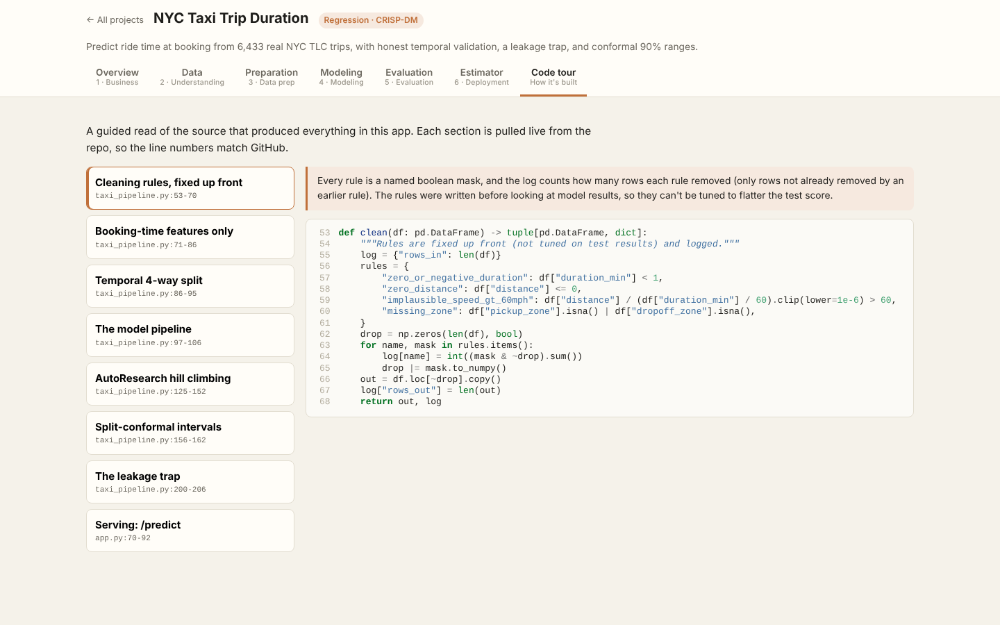

# NYC Taxi Trip Duration

> Part of the [Data Science Full-Stack Lab](../../README.md) · replicates and extends the prompts in [dlmastery/data_science_examples](https://github.com/dlmastery/data_science_examples)


Predict how long a NYC taxi ride will take **at booking time**, with an honest uncertainty range.

**Data:** 6,433 real NYC TLC yellow/green rides, March 2019 ([seaborn mirror](https://github.com/mwaskom/seaborn-data)). 6,317 remain after fixed cleaning rules.

### Results (frozen final week, Mar 25–31, scored once)
| Model | MAE (min) | RMSLE | R² |
|---|---|---|---|
| Global median (baseline) | 7.69 | 0.659 | -0.082 |
| Distance / median speed (10.1 mph) | 7.00 | 0.411 | -0.598 |
| Ridge (one-hot zones + time) | 3.35 | 0.279 | 0.773 |
| HistGBM default | 2.94 | 0.255 | 0.840 |
| HistGBM + AutoResearch (champion) 🏆 | 2.92 | 0.253 | 0.842 |

**Conformal 80/90/95% intervals** (calibrated on Mar 21–24):
| Target | Achieved on test week | Median width |
|---|---|---|
| 80% | 79.8% | 7.7 min |
| 90% | 89.8% | 10.6 min |
| 95% | 96.2% | 13.6 min |

**The leakage trap:** retraining the same model with `fare, tip, tolls, total` gives MAE 1.23 min / R² 0.940, which looks 2.4× better and is useless in production, because the fare doesn't exist until the ride ends. It's kept in the report as a permanent regression check.

### What's improvised vs the original prompt
| Original | Here |
|---|---|
| Synthetic "Kaggle-like" data generator | Real TLC rides, checksummed |
| Random 80/20 split | 4-way **temporal** split (fit → tune → calibrate → test) |
| Point estimate | Point estimate **+ split-conformal 80/90/95% ranges, coverage verified** |
| Interactive map | The source data has zones but no coordinates, so the map became a zone-pair estimator with a 24-hour curve and a day × hour heatmap (no invented coordinates) |
| — | Deliberate leakage demo, PSI drift monitor, error slices, permutation importance |
| AutoResearch hill climbing | Kept: greedy hill climbing on the tune week, every trial logged and plotted |

### Screenshots (every tab, captured by the browser test suite)
| Tab | Screenshot |
|---|---|
| **Overview** |  |
| **Data** |  |
| **Preparation** |  |
| **Modeling** |  |
| **Evaluation** |  |
| **Estimator** |  |
| **Code Tour** |  |

### Run it
```bash
# from the repository root
python data/fetch_data.py                         # once: downloads + checksums the real data
python projects/01_nyc_taxi/taxi_pipeline.py           # re-train (artifacts are already committed)
python serve.py                                   # → http://127.0.0.1:8000/p/01_nyc_taxi/
python -m pytest projects/01_nyc_taxi         # guardrail tests
```

### Tests
- `test_no_post_trip_fields_in_features`
- `test_split_is_strictly_chronological`
- `test_champion_beats_baselines`
- `test_conformal_coverage_close_to_target`
- `test_leak_demo_is_suspiciously_good`
- `test_predict_endpoint`

### Files
| File | Purpose |
|---|---|
| `taxi_pipeline.py` | CRISP-DM pipeline: data → features → models → evaluation → `artifacts/report.json` |
| `app.py` | FastAPI routes for this app (mounted by `shared/hub.py`) |
| `static/` | Front end (HTML + vanilla JS + Plotly) |
| `code_tour.json` | Annotated source sections shown in the app's **Code tour** tab |
| `tests/` | pytest guardrails |
| `artifacts/` | Trained model + report (every number in the UI comes from here) |
