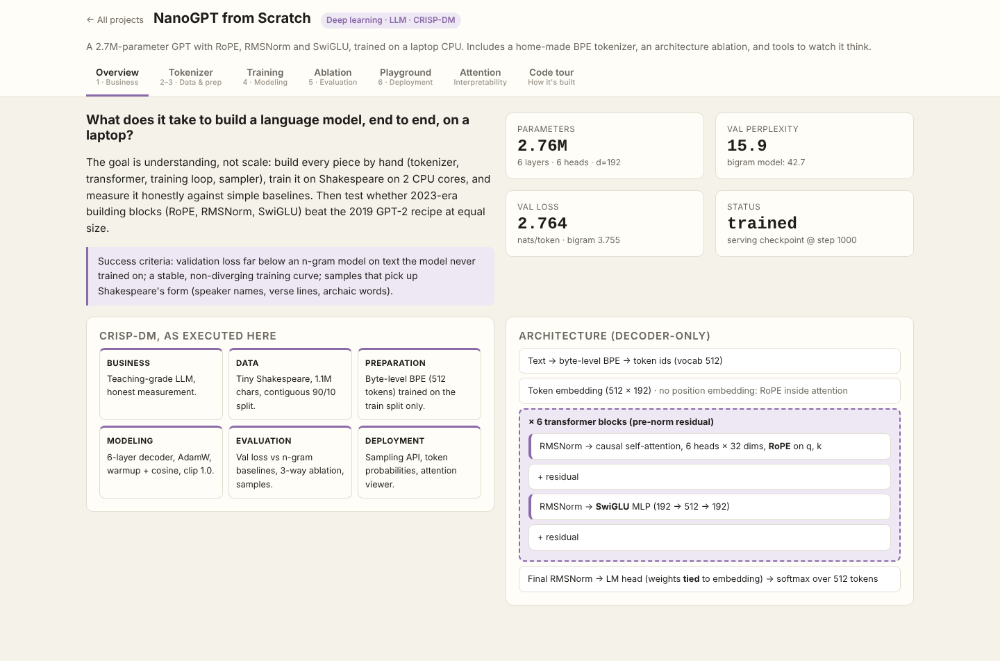
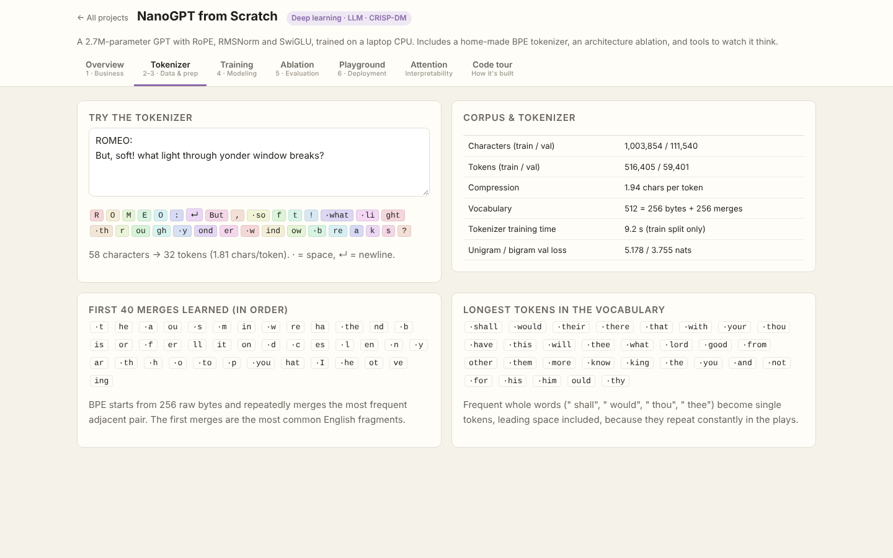
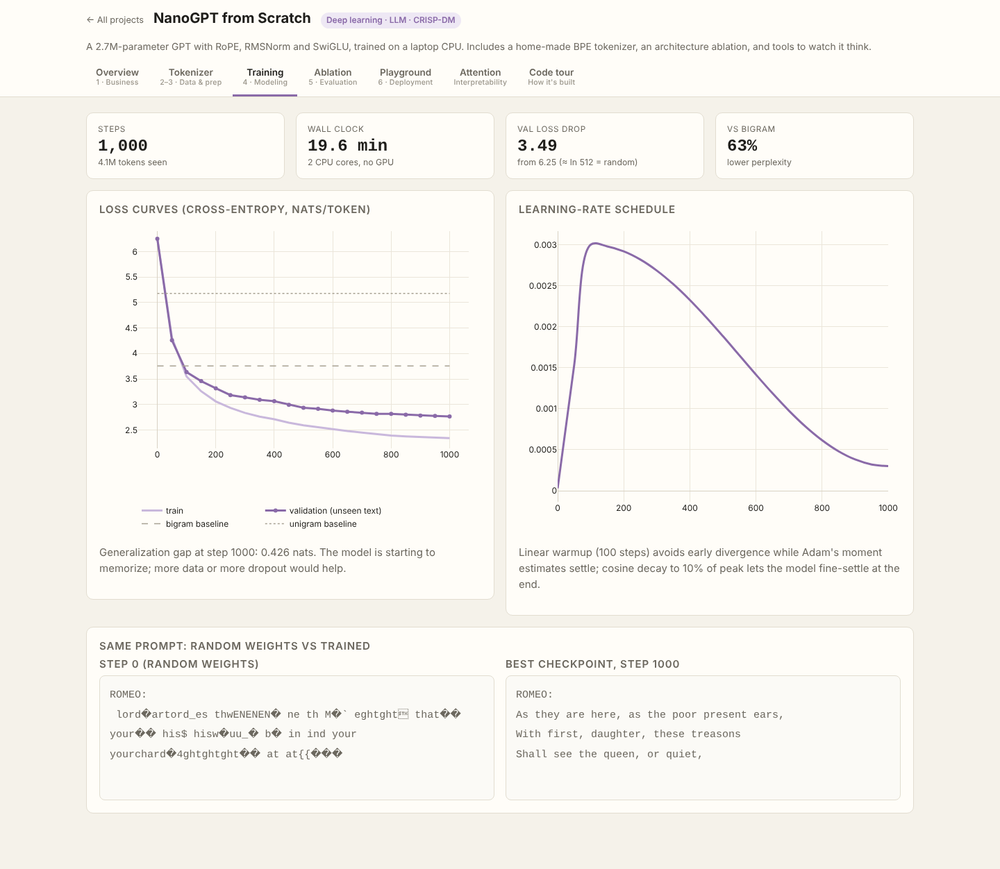
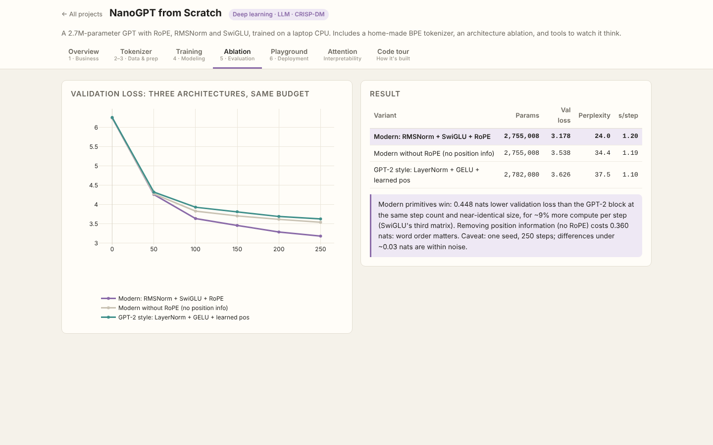
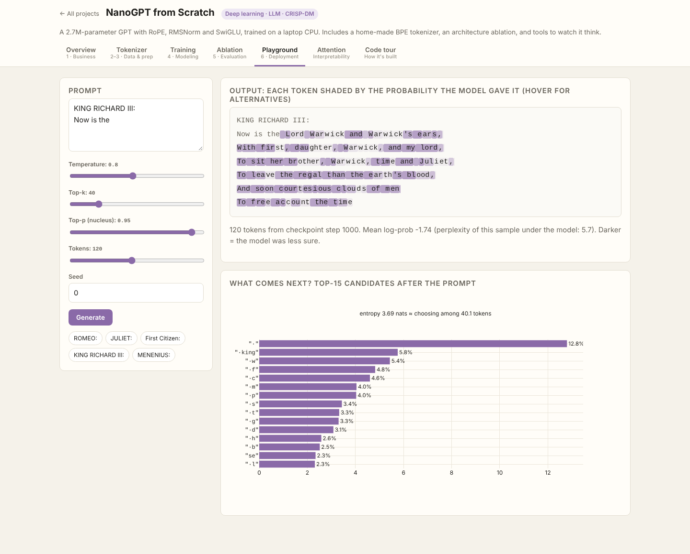
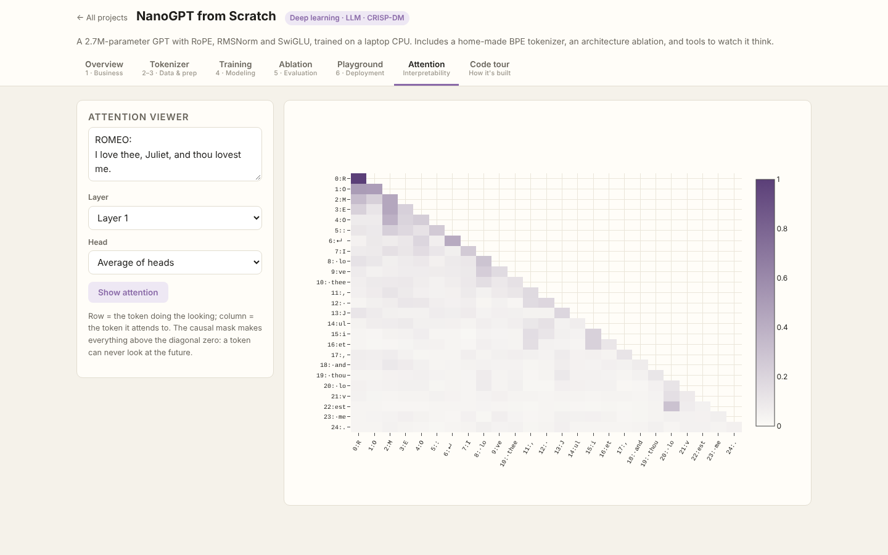
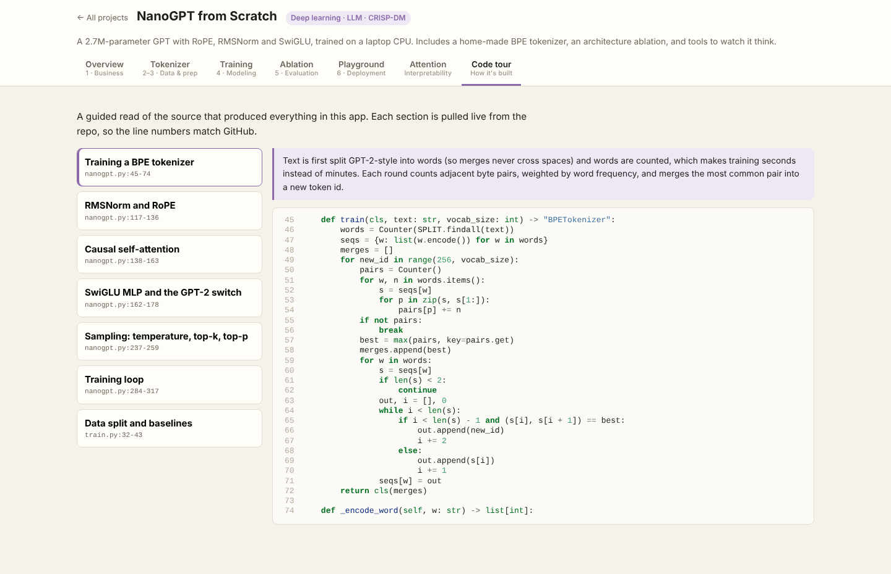

# NanoGPT from Scratch

> Part of the [Data Science Full-Stack Lab](../../README.md) · replicates and extends the prompts in [dlmastery/data_science_examples](https://github.com/dlmastery/data_science_examples)


A decoder-only transformer, written from first principles and trained on **2 CPU cores**: tokenizer, model, training loop, sampler, and the tools to look inside it.

**Data:** Tiny Shakespeare (1.1M characters), contiguous 90/10 split. Byte-level BPE with 512 tokens (≈ 1.94 chars/token), trained on the training split only.

**Model:** 2,755,008 parameters · 6 layers · 6 heads · d=192 · context 128 · RoPE · RMSNorm · SwiGLU · tied embeddings · AdamW (warmup + cosine) · grad clip 1.0.

### Results (held-out last 10% of the text)
| Model | Val loss (nats/token) | Perplexity |
|---|---|---|
| Unigram (add-one) | 5.178 | 177.4 |
| Bigram (add-one) | 3.755 | 42.7 |
| **NanoGPT, 1000 steps** | **2.764** | **15.9** |

Training took 19.6 minutes on CPU.

### Ablation: do 2023-era building blocks help at this scale?
Same steps, same data, same seed, near-identical parameter counts:

| Variant | Params | Val loss | Perplexity | s/step |
|---|---|---|---|---|
| Modern: RMSNorm + SwiGLU + RoPE | 2,755,008 | 3.178 | 24.0 | 1.20 |
| Modern without RoPE (no position info) | 2,755,008 | 3.538 | 34.4 | 1.19 |
| GPT-2 style: LayerNorm + GELU + learned pos | 2,782,080 | 3.626 | 37.5 | 1.10 |

### Samples (temperature 0.8, top-k 40, top-p 0.95)
```text
ROMEO:
As they are here, as the poor present ears,
With first, daughter, these treasons
Shall see the queen, or quiet, and his case.
Ay, I'll hear the regal than
```

```text
First Citizen:
We are few, or say I'll give him to the crown.

CAMILLO:
And cry 'tis no rude: and here, 'tis well.

ISABELLA:
Now, let me see this country's bou
```

### What's improvised vs the original prompt
| Original | Here |
|---|---|
| "Fit in my laptop GPU" | Fits on a 2-core **CPU**: 2.7M params, ~20–30 min |
| Pre-built tokenizer | **Home-made byte-level BPE**, trained on train split only (no val leakage) |
| HP hill climbing | Replaced by a **controlled architecture ablation** (modern vs no-RoPE vs GPT-2), a better use of a small compute budget |
| Chat UI | Playground with **per-token probabilities** (hover for alternatives), next-token entropy, **attention heatmaps** per layer/head |
| — | Unit tests: causal mask, RoPE relative-position property, tokenizer roundtrip |

### Screenshots (every tab, captured by the browser test suite)
| Tab | Screenshot |
|---|---|
| **Overview** |  |
| **Tokenizer** |  |
| **Training** |  |
| **Ablation** |  |
| **Playground** |  |
| **Attention** |  |
| **Code Tour** |  |

### Run it
```bash
# from the repository root
python data/fetch_data.py                         # once: downloads + checksums the real data
python projects/02_nano_llm/train.py           # re-train (artifacts are already committed)
python serve.py                                   # → http://127.0.0.1:8000/p/02_nano_llm/
python -m pytest projects/02_nano_llm         # guardrail tests
```

### Tests
- `test_tokenizer_roundtrip`
- `test_causal_mask_blocks_the_future`
- `test_rope_preserves_norm_and_is_relative`
- `test_ablation_variants_have_similar_size`
- `test_trained_model_beats_bigram`

### Files
| File | Purpose |
|---|---|
| `train.py` | CRISP-DM pipeline: data → features → models → evaluation → `artifacts/report.json` |
| `app.py` | FastAPI routes for this app (mounted by `shared/hub.py`) |
| `static/` | Front end (HTML + vanilla JS + Plotly) |
| `code_tour.json` | Annotated source sections shown in the app's **Code tour** tab |
| `tests/` | pytest guardrails |
| `artifacts/` | Trained model + report (every number in the UI comes from here) |
