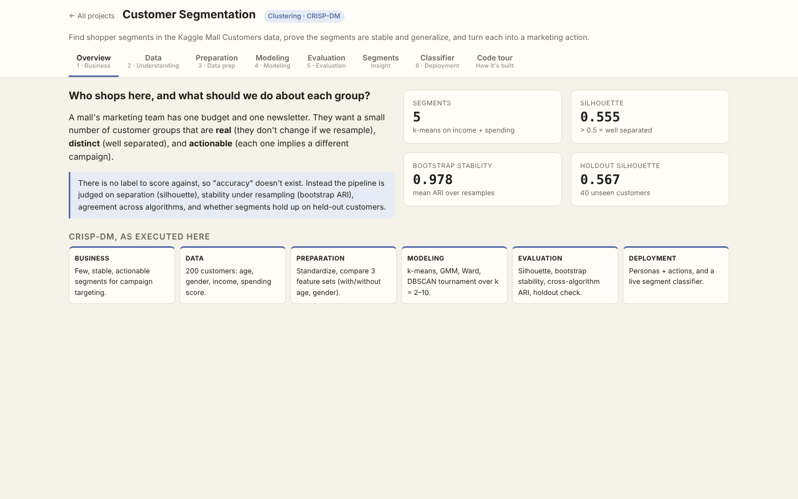
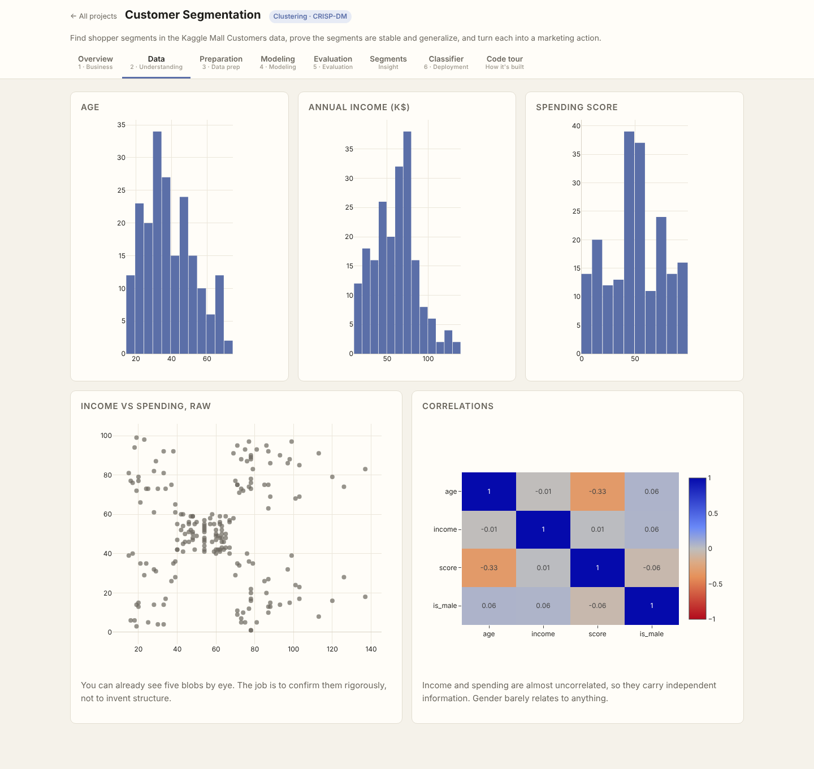
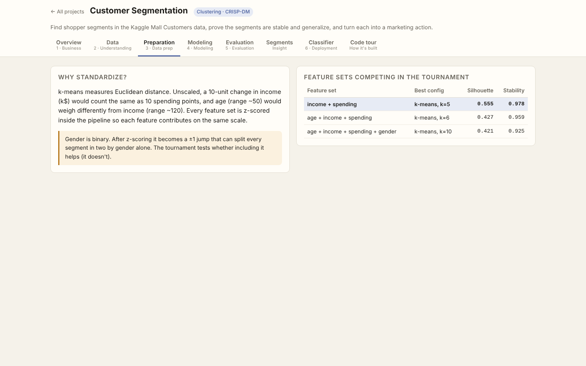
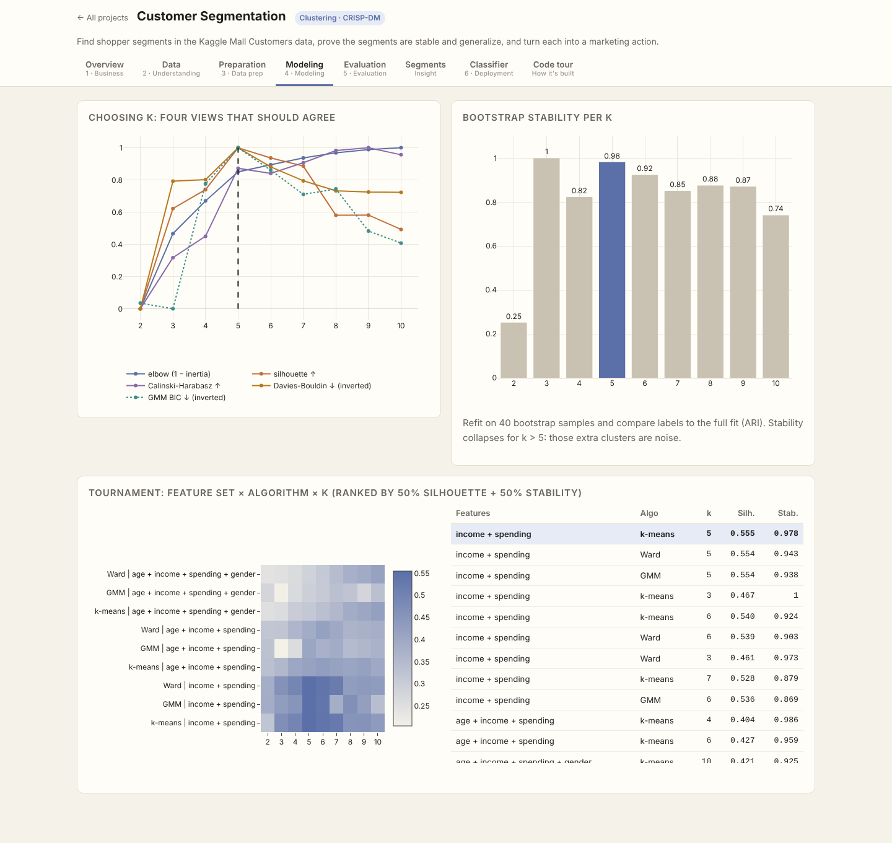
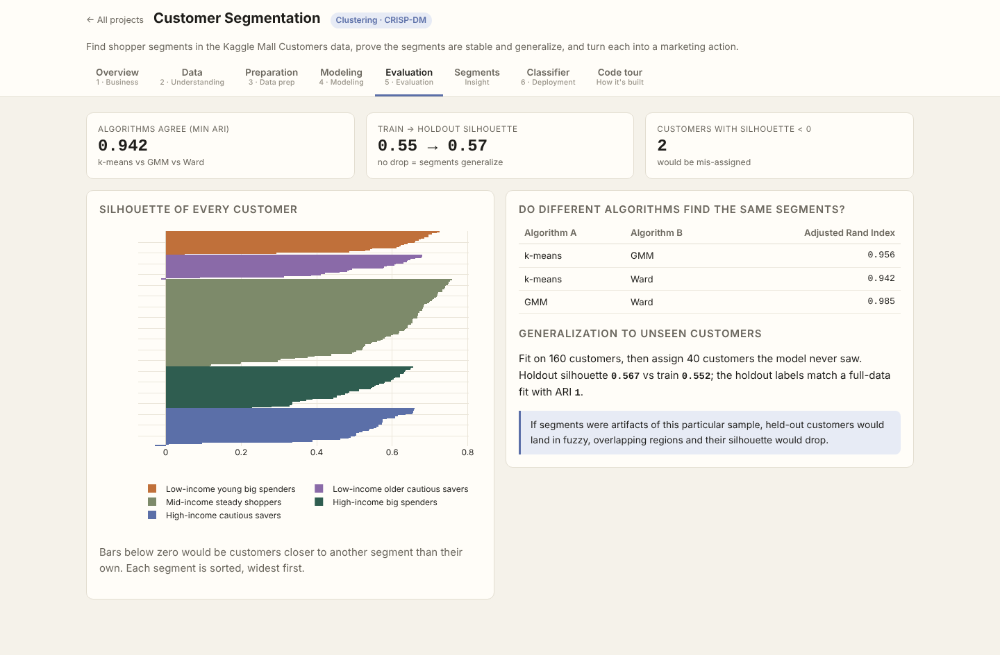
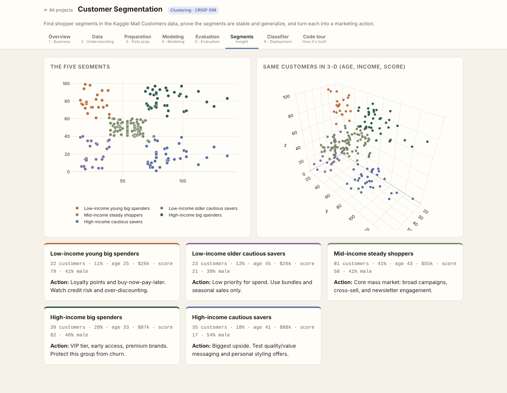
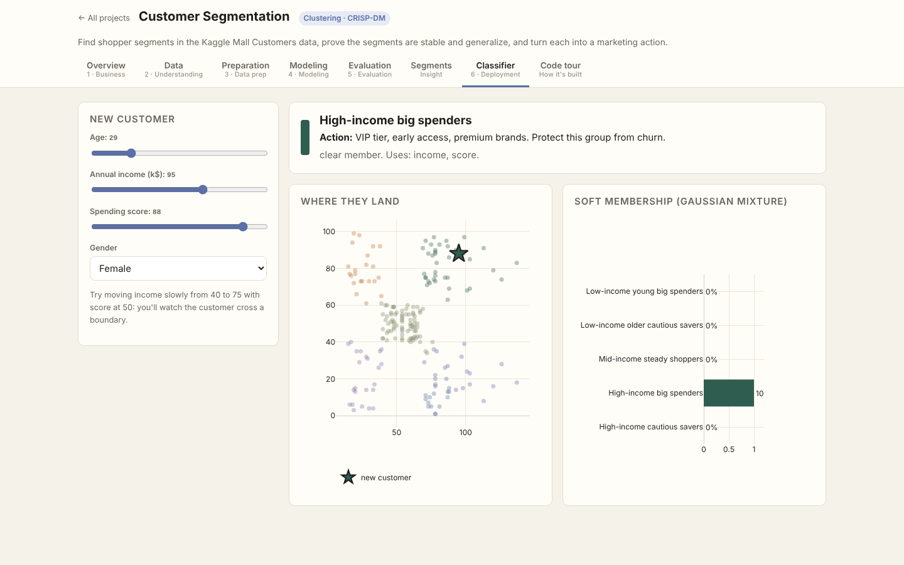
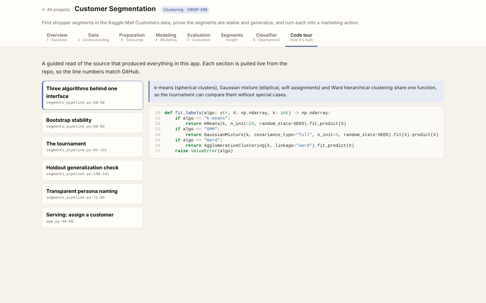

# Customer Segmentation

> Part of the [Data Science Full-Stack Lab](../../README.md) · replicates and extends the prompts in [dlmastery/data_science_examples](https://github.com/dlmastery/data_science_examples)


Find shopper segments in the Kaggle **Mall Customer Segmentation** data (200 customers), prove they're real, and turn each into a marketing action.

### Results
| Check | Result |
|---|---|
| Chosen configuration | k-means, k = 5, features: income + spending |
| Silhouette | 0.555 |
| Bootstrap stability (mean ARI) | 0.978 |
| Cross-algorithm agreement (ARI) | k-means–GMM 0.96, k-means–Ward 0.94, GMM–Ward 0.98 |
| Holdout: train → unseen 20% silhouette | 0.552 → 0.567 (ARI vs full fit 1.00) |

| Segment | n | Age | Income k$ | Score | Action |
|---|---|---|---|---|---|
| Low-income young big spenders | 22 | 25 | 26 | 79 | Loyalty points and buy-now-pay-later. Watch credit risk and over-discounting. |
| Low-income older cautious savers | 23 | 45 | 26 | 21 | Low priority for spend. Use bundles and seasonal sales only. |
| Mid-income steady shoppers | 81 | 43 | 55 | 50 | Core mass market: broad campaigns, cross-sell, and newsletter engagement. |
| High-income big spenders | 39 | 33 | 87 | 82 | VIP tier, early access, premium brands. Protect this group from churn. |
| High-income cautious savers | 35 | 41 | 88 | 17 | Biggest upside. Test quality/value messaging and personal styling offers. |

### What's improvised vs the original prompt
| Original | Here |
|---|---|
| Elbow + silhouette | 5 criteria side by side **plus bootstrap stability**, the tie-breaker when criteria disagree |
| One algorithm | **Tournament**: 3 feature sets × k-means/GMM/Ward/DBSCAN × k = 2–10 |
| — | **Holdout generalization** check for an unsupervised model |
| Hand-written personas | Personas from transparent rules on centroids, each tied to an action |
| — | Live classifier with GMM soft membership and a "borderline" flag |

### Screenshots (every tab, captured by the browser test suite)
| Tab | Screenshot |
|---|---|
| **Overview** |  |
| **Data** |  |
| **Preparation** |  |
| **Modeling** |  |
| **Evaluation** |  |
| **Segments** |  |
| **Classifier** |  |
| **Code Tour** |  |

### Run it
```bash
# from the repository root
python data/fetch_data.py                         # once: downloads + checksums the real data
python projects/03_customer_segments/segments_pipeline.py           # re-train (artifacts are already committed)
python serve.py                                   # → http://127.0.0.1:8000/p/03_customer_segments/
python -m pytest projects/03_customer_segments         # guardrail tests
```

### Tests
- `test_chosen_segmentation_is_stable_and_separated`
- `test_segments_generalize_to_holdout`
- `test_algorithms_agree`
- `test_every_customer_assigned_and_profiles_cover_all`
- `test_assign_endpoint`

### Files
| File | Purpose |
|---|---|
| `segments_pipeline.py` | CRISP-DM pipeline: data → features → models → evaluation → `artifacts/report.json` |
| `app.py` | FastAPI routes for this app (mounted by `shared/hub.py`) |
| `static/` | Front end (HTML + vanilla JS + Plotly) |
| `code_tour.json` | Annotated source sections shown in the app's **Code tour** tab |
| `tests/` | pytest guardrails |
| `artifacts/` | Trained model + report (every number in the UI comes from here) |
