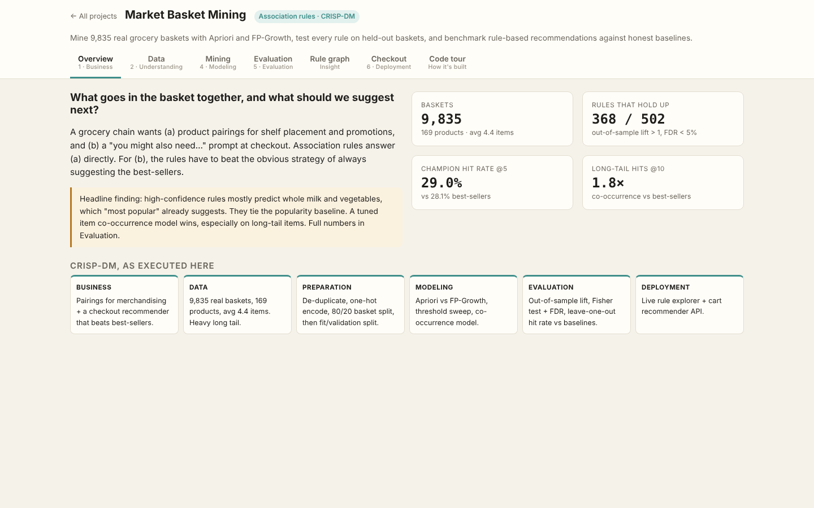
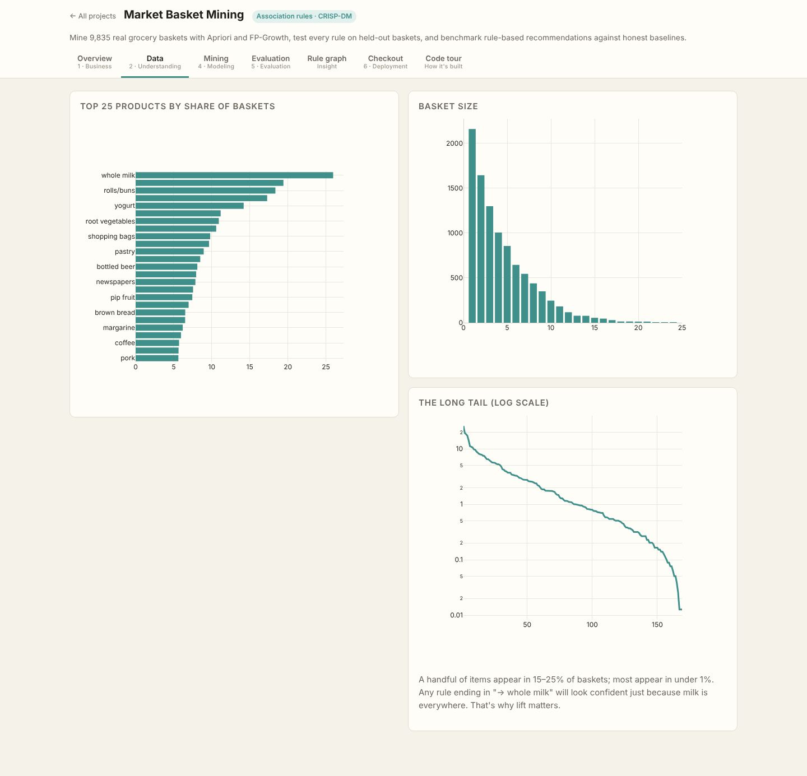
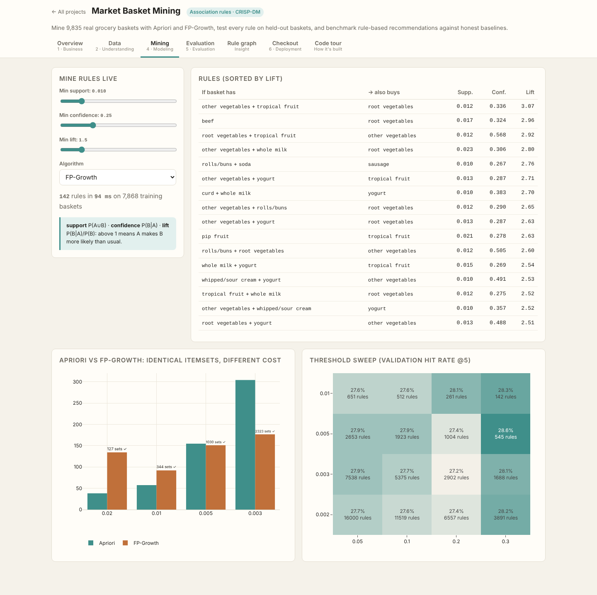
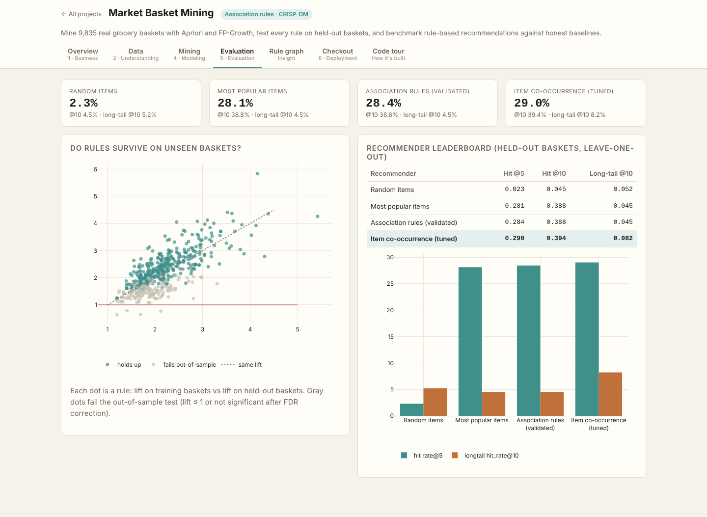
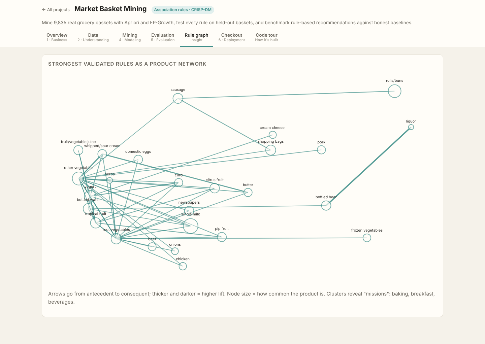
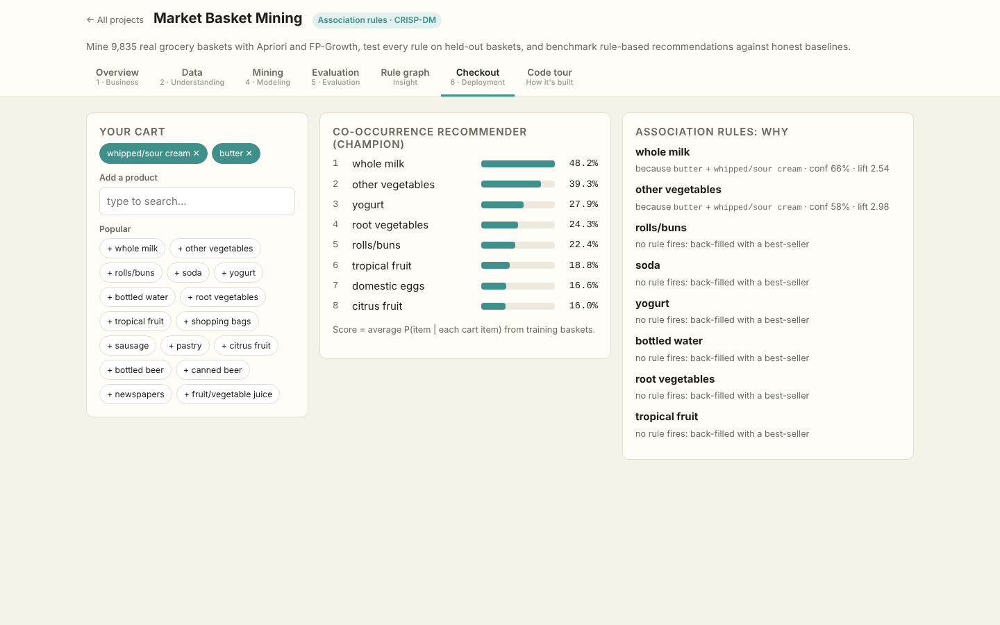
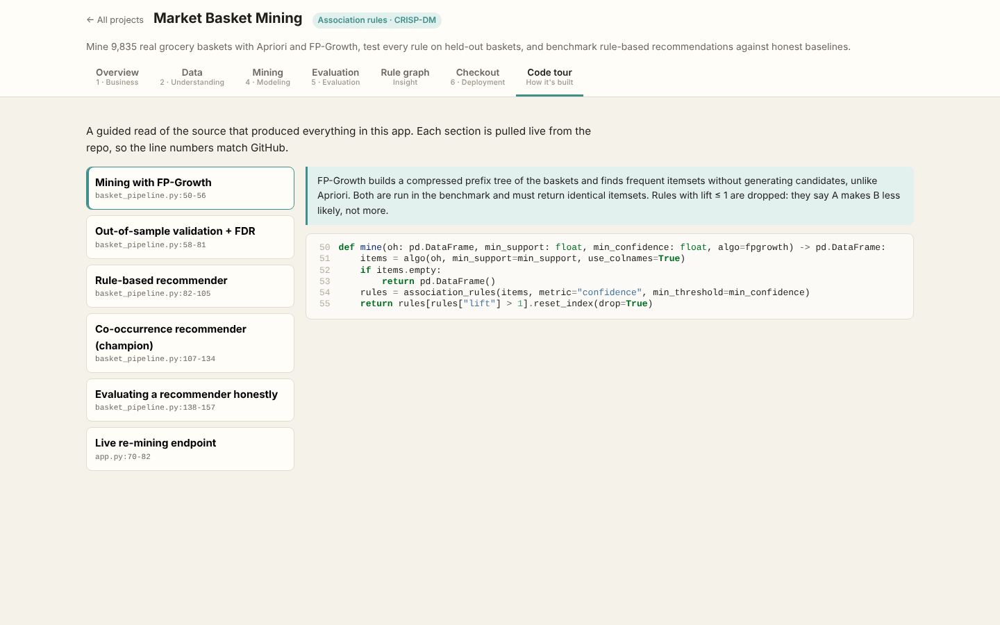

# Market Basket Mining

> Part of the [Data Science Full-Stack Lab](../../README.md) · replicates and extends the prompts in [dlmastery/data_science_examples](https://github.com/dlmastery/data_science_examples)


Association rules on **9,835 real grocery baskets** (169 products; the classic *Groceries* dataset used on Kaggle and in R's `arules`).

### Results
**368 of 502 rules hold up** on held-out baskets (lift > 1 and Benjamini-Hochberg q < 0.05).

Strongest validated rules:
| If basket has | → also buys | Train lift | Held-out lift | FDR q |
|---|---|---|---|---|
| liquor | bottled beer | 5.42 | 4.26 | 3.8e-03 |
| citrus fruit + root vegetables | other vegetables + whole milk | 4.38 | 4.35 | 9.0e-05 |
| butter + other vegetables | whipped/sour cream | 4.31 | 2.78 | 2.5e-02 |
| root vegetables + tropical fruit | other vegetables + whole milk | 4.15 | 5.83 | 0.0e+00 |
| citrus fruit + other vegetables + whole milk | root vegetables | 4.13 | 3.93 | 1.4e-04 |
| herbs | root vegetables | 4.03 | 3.57 | 6.5e-04 |
| onions + other vegetables | root vegetables | 3.87 | 2.88 | 4.8e-03 |
| citrus fruit + pip fruit | tropical fruit | 3.83 | 3.95 | 1.1e-03 |

**Recommender leaderboard** (leave-one-out on 1,967 held-out baskets):
| Recommender | Hit @5 | Hit @10 | Long-tail hit @10 |
|---|---|---|---|
| Random items | 2.3% | 4.5% | 5.2% |
| Most popular items | 28.1% | 38.8% | 4.5% |
| Association rules (validated) | 28.4% | 38.8% | 4.5% |
| Item co-occurrence (tuned) | 29.0% | 39.4% | 8.2% |

> **Honest finding:** high-confidence rules only tie "recommend the best-sellers", because confident rules mostly predict whole milk and vegetables. A tuned item co-occurrence model wins overall and nearly **doubles** best-sellers on long-tail items, which is where recommendations actually add value.

**Apriori vs FP-Growth** (same answers, different cost):
| min support | itemsets | Apriori ms | FP-Growth ms | identical |
|---|---|---|---|---|
| 0.02 | 127 | 38 | 134 | ✓ |
| 0.01 | 344 | 57 | 92 | ✓ |
| 0.005 | 1030 | 155 | 151 | ✓ |
| 0.003 | 2323 | 304 | 177 | ✓ |

### What's improvised vs the original prompt
| Original | Here |
|---|---|
| Mine rules, show them | Mine on 80%, **re-test every rule on held-out 20%** with Fisher exact test + FDR |
| — | Recommender evaluated **as a recommender** (leave-one-out hit-rate vs baselines, long-tail metric) |
| — | Thresholds chosen on a validation split, never on test |
| — | Co-occurrence recommender when rules didn't beat the baseline |
| Static rule table | Live re-mining sliders, rule network graph, interactive checkout cart |

### Screenshots (every tab, captured by the browser test suite)
| Tab | Screenshot |
|---|---|
| **Overview** |  |
| **Data** |  |
| **Mining** |  |
| **Evaluation** |  |
| **Rule Graph** |  |
| **Checkout** |  |
| **Code Tour** |  |

### Run it
```bash
# from the repository root
python data/fetch_data.py                         # once: downloads + checksums the real data
python projects/04_market_basket/basket_pipeline.py           # re-train (artifacts are already committed)
python serve.py                                   # → http://127.0.0.1:8000/p/04_market_basket/
python -m pytest projects/04_market_basket         # guardrail tests
```

### Tests
- `test_apriori_and_fpgrowth_agree`
- `test_all_rules_have_lift_above_one_in_training`
- `test_validated_rules_hold_out_of_sample`
- `test_champion_beats_random_and_popularity`
- `test_recommender_never_suggests_items_in_cart`
- `test_api_mine_and_recommend`

### Files
| File | Purpose |
|---|---|
| `basket_pipeline.py` | CRISP-DM pipeline: data → features → models → evaluation → `artifacts/report.json` |
| `app.py` | FastAPI routes for this app (mounted by `shared/hub.py`) |
| `static/` | Front end (HTML + vanilla JS + Plotly) |
| `code_tour.json` | Annotated source sections shown in the app's **Code tour** tab |
| `tests/` | pytest guardrails |
| `artifacts/` | Trained model + report (every number in the UI comes from here) |
