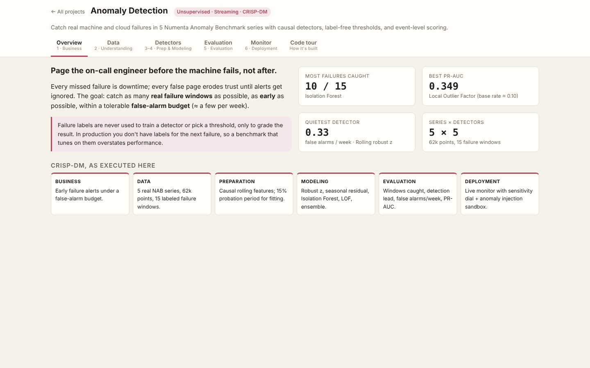
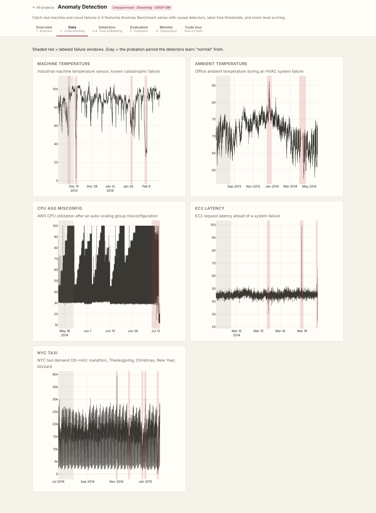
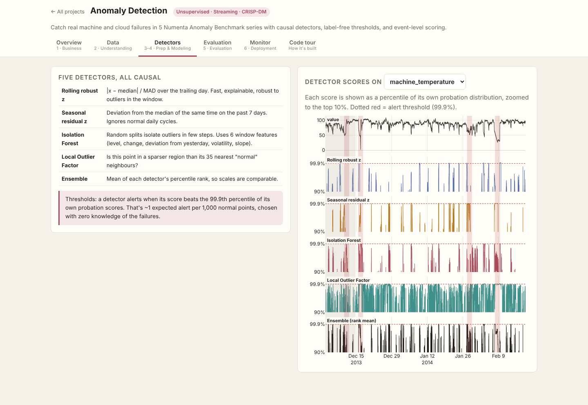
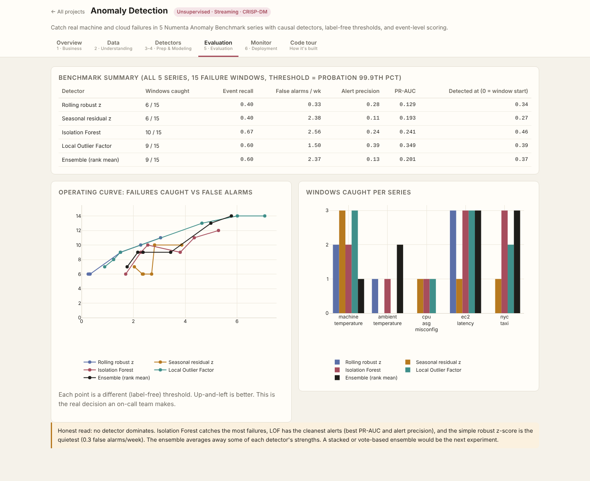
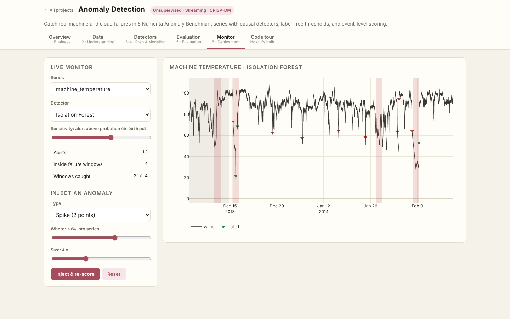
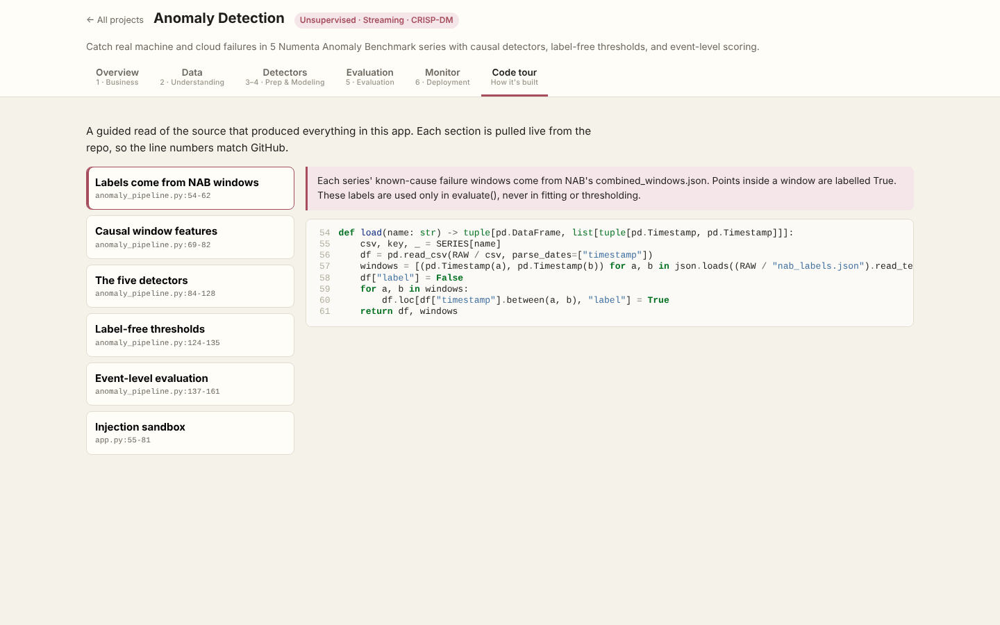

# Anomaly Detection

> Part of the [Data Science Full-Stack Lab](../../README.md) · replicates and extends the prompts in [dlmastery/data_science_examples](https://github.com/dlmastery/data_science_examples)


Catch real system failures in **5 Numenta Anomaly Benchmark (NAB) series** with known-cause failure windows:
- **machine temperature**: Industrial machine temperature sensor; known catastrophic failure
- **ambient temperature**: Office ambient temperature during an HVAC system failure
- **cpu asg misconfig**: AWS CPU utilization after an auto-scaling group misconfiguration
- **ec2 latency**: EC2 request latency ahead of a system failure
- **nyc taxi**: NYC taxi demand (30-min): marathon, Thanksgiving, Christmas, New Year, blizzard

### Rules that make the numbers trustworthy
- Every detector is **causal** (score at *t* uses data ≤ *t*). A unit test changes the future and asserts past scores don't move.
- Detectors are fit on the first 15% of each series (NAB's probation period) only.
- **Thresholds are label-free**: the 99.9th percentile of each detector's own probation scores. Labels are only used to grade.

### Results (15 failure windows across 5 series)
| Detector | Failures caught | False alarms / week | Alert precision | PR-AUC |
|---|---|---|---|---|
| Rolling robust z | 6 / 15 | 0.33 | 0.28 | 0.129 |
| Seasonal residual z | 6 / 15 | 2.38 | 0.11 | 0.193 |
| Isolation Forest | 10 / 15 | 2.56 | 0.24 | 0.241 |
| Local Outlier Factor | 9 / 15 | 1.50 | 0.39 | 0.349 |
| Ensemble (rank mean) | 9 / 15 | 2.37 | 0.13 | 0.201 |

No detector dominates: Isolation Forest catches the most failures, LOF raises the cleanest alerts, and the robust z-score is the quietest. The rank ensemble does not beat its parts, and the README says so rather than hiding it. The operating curve in the app shows the full catch-vs-false-alarm trade-off.

### What's improvised vs the original prompt
| Original | Here |
|---|---|
| Kaggle tabular fraud-style data, point metrics | Real **streaming** failures, **event-level** scoring (caught, how early, false alarms/week) |
| Thresholds tuned for best F1 (uses labels) | **Label-free** thresholds from probation data |
| — | Operating curve across sensitivities |
| — | **Anomaly injection sandbox**: add spike / level shift / drift / stuck sensor and re-score live |

### Screenshots (every tab, captured by the browser test suite)
| Tab | Screenshot |
|---|---|
| **Overview** |  |
| **Data** |  |
| **Detectors** |  |
| **Evaluation** |  |
| **Monitor** |  |
| **Code Tour** |  |

### Run it
```bash
# from the repository root
python data/fetch_data.py                         # once: downloads + checksums the real data
python projects/06_anomaly_detection/anomaly_pipeline.py           # re-train (artifacts are already committed)
python serve.py                                   # → http://127.0.0.1:8000/p/06_anomaly_detection/
python -m pytest projects/06_anomaly_detection         # guardrail tests
```

### Tests
- `test_detectors_are_causal`
- `test_no_alerts_during_probation`
- `test_every_detector_beats_random_pr_auc`
- `test_injected_spike_is_caught`
- `test_summary_counts_consistent`

### Files
| File | Purpose |
|---|---|
| `anomaly_pipeline.py` | CRISP-DM pipeline: data → features → models → evaluation → `artifacts/report.json` |
| `app.py` | FastAPI routes for this app (mounted by `shared/hub.py`) |
| `static/` | Front end (HTML + vanilla JS + Plotly) |
| `code_tour.json` | Annotated source sections shown in the app's **Code tour** tab |
| `tests/` | pytest guardrails |
| `artifacts/` | Trained model + report (every number in the UI comes from here) |
