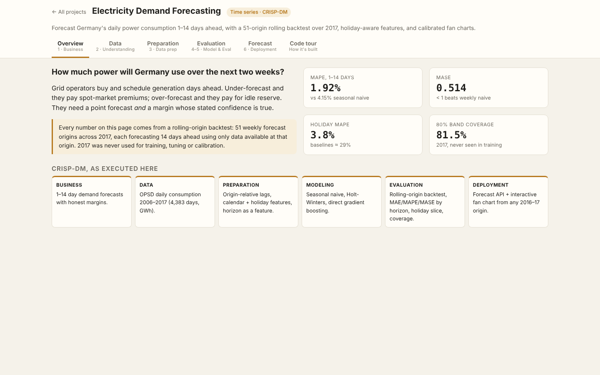
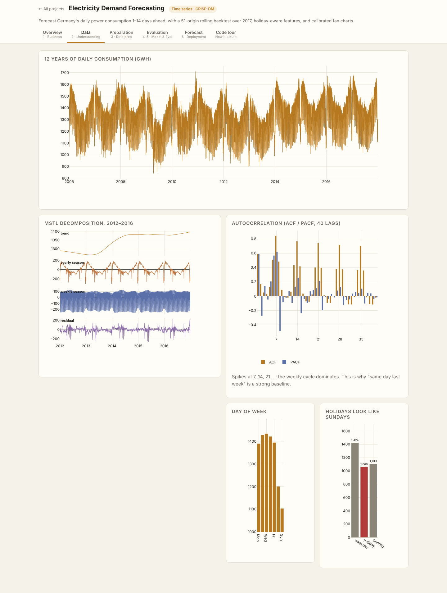
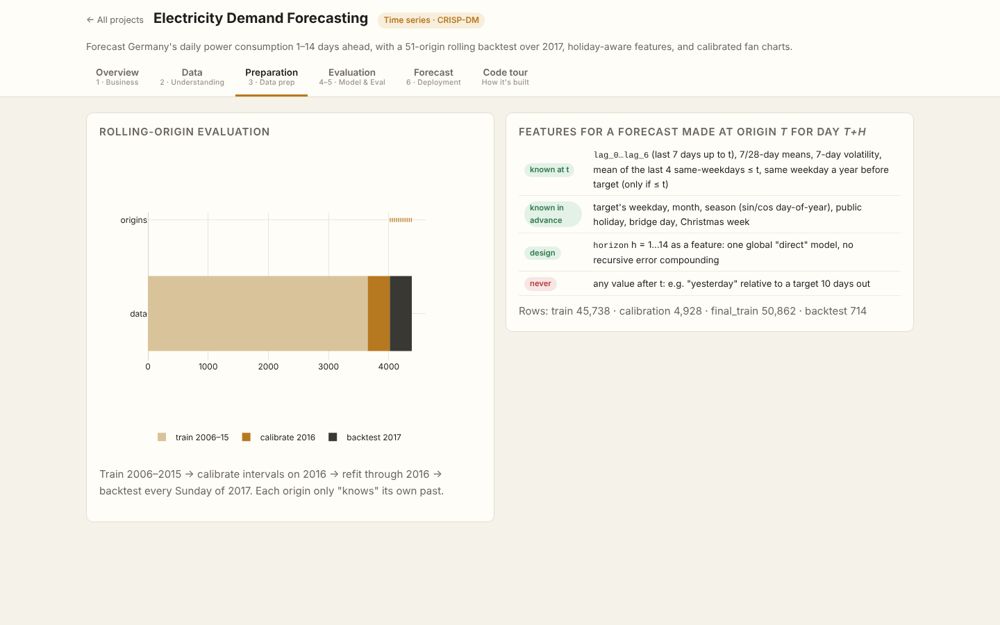
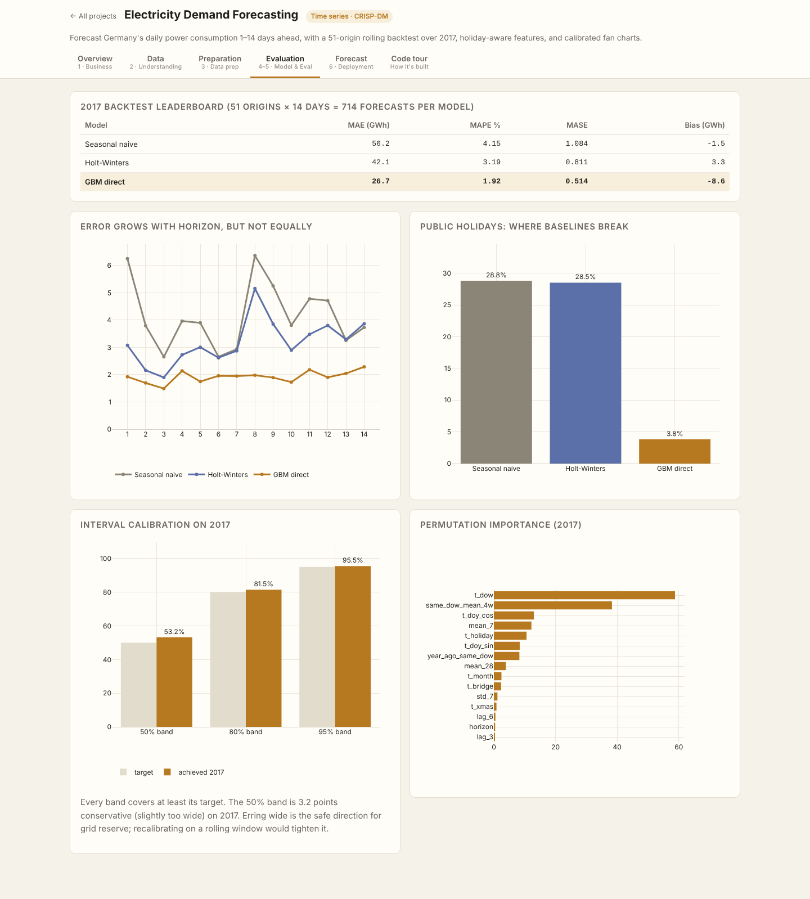
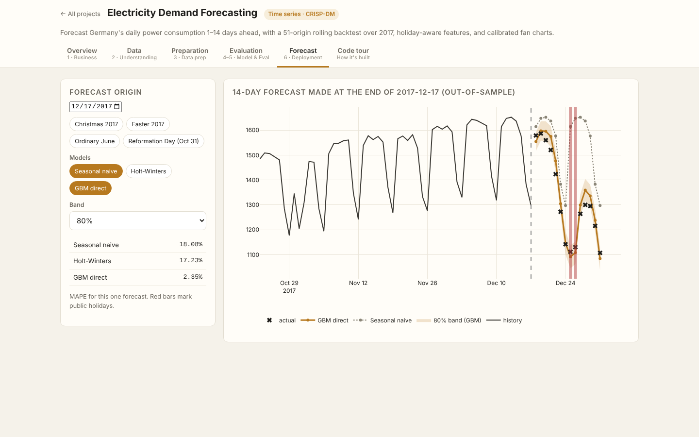
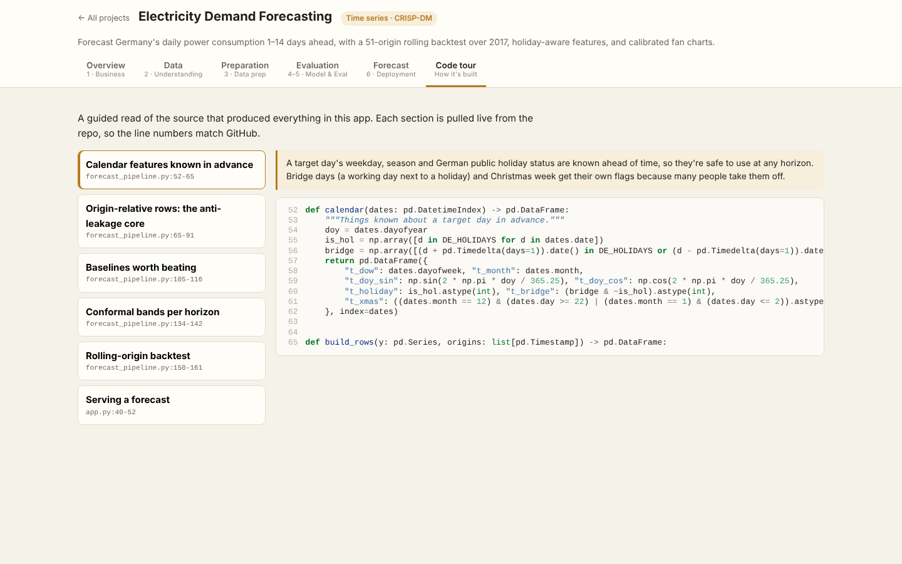

# Electricity Demand Forecasting

> Part of the [Data Science Full-Stack Lab](../../README.md) · replicates and extends the prompts in [dlmastery/data_science_examples](https://github.com/dlmastery/data_science_examples)


Forecast **Germany's daily electricity consumption 1–14 days ahead** (Open Power System Data, 2006–2017).

### Validation design
Train 2006–2015 → calibrate intervals on 2016 → refit through 2016 → **rolling-origin backtest over all of 2017** (51 weekly origins × 14 days). Every lag is taken relative to the forecast **origin**; calendar features and German public holidays are allowed because they are known in advance. A unit test corrupts all data after the origin and asserts no feature changes.

### Results (2017, never used for training or tuning)
| Model | MAE (GWh) | MAPE | MASE |
|---|---|---|---|
| Seasonal naive | 56.2 | 4.15% | 1.084 |
| Holt-Winters | 42.1 | 3.19% | 0.811 |
| GBM direct | 26.7 | 1.92% | 0.514 |

| Model | MAPE on public holidays |
|---|---|
| Seasonal naive | 28.8% |
| Holt-Winters | 28.5% |
| GBM direct | 3.8% |

**Per-horizon conformal bands** (calibrated on every daily origin of 2016):
| Band | 2017 coverage | Mean half-width |
|---|---|---|
| 50% | 53.2% | 22.1 GWh |
| 80% | 81.5% | 43.7 GWh |
| 95% | 95.5% | 72.9 GWh |

### What's improvised vs the original prompt
| Original | Here |
|---|---|
| Single train/test split | **Rolling-origin backtest**, 714 forecasts per model |
| — | **Direct multi-horizon** model (horizon as a feature, no recursive error compounding) |
| — | MASE, horizon curves, holiday error slice |
| — | Conformal fan charts with verified coverage |
| Static dashboards | Forecast from any 2016–17 origin; presets for Christmas, Easter, Reformation Day |

### Screenshots (every tab, captured by the browser test suite)
| Tab | Screenshot |
|---|---|
| **Overview** |  |
| **Data** |  |
| **Preparation** |  |
| **Evaluation** |  |
| **Forecast** |  |
| **Code Tour** |  |

### Run it
```bash
# from the repository root
python data/fetch_data.py                         # once: downloads + checksums the real data
python projects/12_timeseries_forecasting/forecast_pipeline.py           # re-train (artifacts are already committed)
python serve.py                                   # → http://127.0.0.1:8000/p/12_timeseries_forecasting/
python -m pytest projects/12_timeseries_forecasting         # guardrail tests
```

### Tests
- `test_rows_never_use_data_after_origin`
- `test_gbm_beats_seasonal_naive`
- `test_bands_are_nested_at_every_horizon`
- `test_coverage_reasonable`
- `test_forecast_api`

### Files
| File | Purpose |
|---|---|
| `forecast_pipeline.py` | CRISP-DM pipeline: data → features → models → evaluation → `artifacts/report.json` |
| `app.py` | FastAPI routes for this app (mounted by `shared/hub.py`) |
| `static/` | Front end (HTML + vanilla JS + Plotly) |
| `code_tour.json` | Annotated source sections shown in the app's **Code tour** tab |
| `tests/` | pytest guardrails |
| `artifacts/` | Trained model + report (every number in the UI comes from here) |
